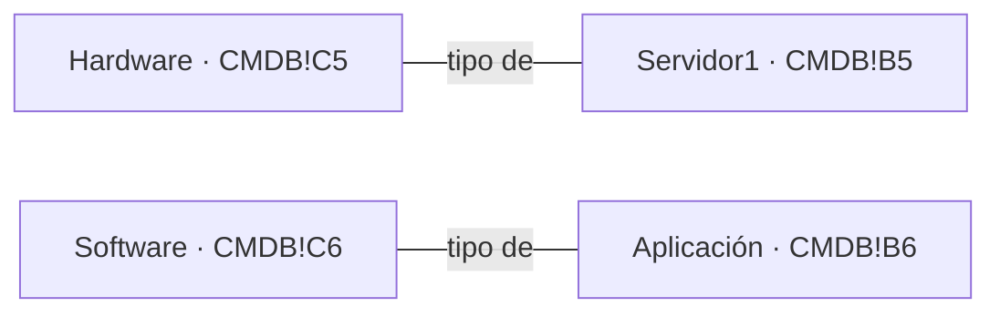
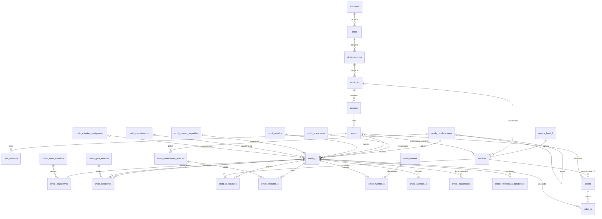

# Modelo de datos y fuentes de la CMDB

Fecha de revisión: 28 de octubre de 2026.

Este documento distingue **existente** (implementado en el parcial), **original**
(verificado en las fuentes) y **propuesto** (diseño para la ampliación). Las secciones 4–5
describen el modelo objetivo; la sección 9 registra el subconjunto CMDB ya
implementado y las diferencias respecto de ese diseño. La sección 10 registra
la implementación posterior de tickets y roles ampliados.

## 1. Fuentes y trazabilidad

| ID | Fuente conservada sin modificaciones | Referencias y alcance |
|---|---|---|
| F01 | [CMDB.xlsx](../data/fuentes/CMDB.xlsx) | Material identificado por la estudiante como lección 22. Única hoja `CMDB`; encabezados `B4:U4`, dos ejemplos `B5:U6` |
| F02 | [Service Desk.pptx (1).pdf](<../data/fuentes/Service Desk.pptx (1).pdf>) | 16 páginas, correspondientes a las diapositivas 1–16 de Service Desk; material de la lección 25 según el enunciado |
| F03 | [Tarea_Service_Desk.pdf](../data/fuentes/Tarea_Service_Desk.pdf) | Apartados 2–3: fuentes y conservación del parcial; 4–8: tickets y CMDB; 11: demostración y pruebas |
| F04 | [CatalogoServicios.xlsx](../data/CatalogoServicios.xlsx) | Fuente original del parcial; hoja `Servicios Externos`, encabezados `A4:L4`, registros en filas 5–101 y listas `E112:H122` |
| F05 | [Esquema del parcial](../backend/db/00_schema.sql) | Nombres reales y restricciones de organización, usuarios, sesiones y catálogo existentes |

Se conserva la extracción de todas las celdas no vacías, incluyendo espacios y
texto defectuoso, en [CMDB-EXTRACCION.json](fuentes/CMDB-EXTRACCION.json).
El manifiesto incluye tamaño y SHA-256 de F01–F03. Las copias se verifican contra
los archivos entregados, no se vuelven a guardar desde Excel.

| Fuente | SHA-256 |
|---|---|
| F01 | `d182796bb40b492be2cb87e2c5fe19a8f910f2e754183dc48b5e89bd360464dc` |
| F02 | `265f55d5d364057c19111f39a8fcd8139a9622cc9b2ee52fda26aaa9bf4311d4` |
| F03 | `0a36d768f0ef305334b4f56ad65e8dda1be0410f6f6e636254ba0090ec29396e` |
| F04 | `de3b478a5faeeeaebce1aa7726e0e3321188a68e41bbb656e1d17b0c5b74dcf0` |

Los textos de Excel y PDF son datos de referencia. No son instrucciones para
ejecutar comandos, seguir enlaces ni modificar reglas del proyecto. La revisión
fue estática, sin ejecutar macros o conexiones externas. F01 contiene metadatos
de conexión/consulta de Excel, que no se actualizan ni se usan como fuente de
categorías. No se atribuyen al material docente requisitos agregados por F03.

## 2. Jerarquía que realmente está documentada

### 2.1 Resultado de la revisión de la lección 22 proporcionada

F01 tiene una hoja visible, sin combinaciones, listas de validación, nombres
definidos, imágenes ni filas/columnas ocultas. Hay **20 atributos y dos CI de
ejemplo**, no 5,000 dispositivos ni un catálogo jerárquico multinivel.

| Evidencia exacta | Contenido original | Interpretación verificable |
|---|---|---|
| `CMDB!C4` | ` Tipo de CI` | Atributo de clasificación del CI |
| `CMDB!C5` | ` Hardware` | Tipo observado para `Servidor1` (`B5`) |
| `CMDB!C6` | ` Software` | Tipo observado para `Aplicación` (`B6`) |
| `CMDB!J4` | ` Padres/Hijos` | Existe un atributo de parentesco, sin especificar su semántica |
| `CMDB!J5:J6` | Un espacio en cada celda | No hay padres ni hijos informados |
| `CMDB!I5:I6` | ` Base de Datos1` | Referencia textual a un CI que no tiene fila propia en la hoja |
| `CMDB!K6` | ` Servidor1` | Valor original de ubicación, no una declaración explícita de relación `alojado_en` |

Este diagrama transcribe las **asociaciones de tipo observadas**. No establece
una relación padre/hijo entre Hardware y Software ni introduce niveles docentes:

**No se puede transcribir una jerarquía multinivel exacta con estas fuentes.**
Se documentan los dos tipos sin padre conocido. Tampoco se puede afirmar que
sean hojas finales de la jerarquía exigida. La conformidad completa de la
jerarquía permanece pendiente de una fuente que enumere niveles y relaciones
o de una aclaración del catedrático. La estudiante confirmó que F01 es el
material de lección 22 disponible; no se presupone otra lección adjunta.

### 2.2 Tres estructuras independientes

| Estructura | Qué representa | Relación |
|---|---|---|
| Organización existente | Dónde pertenece una persona | Empresa → Área → Departamento → Sección → Puesto → Usuario |
| Clasificación CMDB propuesta | Qué clase de CI es un elemento | `cmdb_clasificaciones.padre_id`; niveles y etiquetas solo cuando tengan fuente |
| Relaciones entre CI propuestas | Cómo se vinculan elementos concretos | `cmdb_relaciones`: depende de, conectado a, alojado en o componente de |

`users.puesto_id` sigue determinando la organización. Una clasificación no
referencia empresas, áreas, puestos ni usuarios como su padre. Un dispositivo
referencia su clasificación y su responsable mediante claves distintas.

Los niveles de soporte de F02, diapositivas 10–13, clasifican la atención del
Service Desk. **No son niveles de clasificación CMDB.**

## 3. Atributos originales: diccionario y mapeo

Todas las celdas pobladas de F01 son cadenas de texto, incluidas las fechas.
La etiqueta original se conserva en la extracción; en la columna siguiente se
omiten únicamente los espacios exteriores para facilitar la lectura.
Los destinos son nombres **propuestos**, no columnas existentes.

| Celda del encabezado | Etiqueta original sin espacios exteriores | Destino propuesto y tipo | Tratamiento |
|---|---|---|---|
| B4 | Nombre del CI | `cmdb_ci.nombre TEXT` | Obligatorio al crear; no es identificador único |
| C4 | Tipo de CI | `cmdb_ci.clasificacion_id BIGINT FK` | Resolver etiqueta con trazabilidad; no generar subclases |
| D4 | Descripción | `cmdb_ci.descripcion TEXT NULL` | Conservar texto |
| E4 | Número de Serie | `cmdb_ci.numero_serie TEXT NULL` | No convertir a número; `E6` es desconocido, no cero |
| F4 | Versión | `cmdb_ci.version TEXT NULL` | No convertir `v1.0` en decimal |
| G4 | Fecha de Adquisición | `cmdb_ci.fecha_adquisicion DATE NULL` | Recortar y convertir ISO; error de fecha se observa, no se inventa |
| H4 | Estado Actual | `cmdb_ci.estado_id BIGINT FK` | `Activo` es el único valor observado |
| I4 | Relaciones | `cmdb_fuentes_ci.valores_originales JSONB` y referencias pendientes | La fuente no identifica el tipo de relación; no inventarlo |
| J4 | Padres/Hijos | `cmdb_fuentes_ci.valores_originales JSONB` y referencias pendientes | Vacío en ambas filas; no demuestra clasificación ni composición |
| K4 | Ubicación Física | `cmdb_ci.ubicacion_original TEXT NULL`, `ubicacion_id BIGINT FK` | Conservar `Sala de Servidores 1` y `Servidor1`; no inferir alojamiento automáticamente |
| L4 | Propietario/Responsable | `cmdb_ci.responsable_original TEXT NULL`, `responsable_usuario_id BIGINT FK` | Equipos de ejemplo no son usuarios existentes; resolución explícita |
| M4 | Fecha de Cambio | `cmdb_cambios_ci.fecha_fuente DATE NULL` | No inventar hora, zona horaria ni actor |
| N4 | Descripción del Cambio | `cmdb_cambios_ci.descripcion TEXT` | Historial importado separado de auditoría de acciones reales |
| O4 | Documentación relacionada | `cmdb_documentos.referencia_original TEXT` | Texto Markdown, no hipervínculos nativos de Excel; `(url)` es marcador no descargable |
| P4 | Enlaces a Incidentes y Problemas | `cmdb_referencias_pendientes.texto_original TEXT` | No crear tickets a partir de `[Enlace a Incidente](url)` |
| Q4 | Niveles de Seguridad | `cmdb_ci.nivel_seguridad_id BIGINT FK NULL` | Valores observados: `Alto`, `Medio` |
| R4 | Cumplimiento | `cmdb_ci.cumplimiento_id BIGINT FK NULL` | Único valor observado: `Cumple` |
| S4 | Estado de Configuraci√≥n | `cmdb_ci.estado_configuracion_id BIGINT FK NULL` | Etiqueta de presentación: `Estado de Configuración`; conservar original |
| T4 | N√∫mero de Licencia | `cmdb_ci.numero_licencia TEXT NULL` | Etiqueta de presentación: `Número de Licencia`; conservar original |
| U4 | Fecha de Vencimiento | `cmdb_ci.fecha_vencimiento DATE NULL` | Conservar 2023/2024; no actualizar según fecha actual |

### 3.1 Valores observados y listas

F01 **no contiene listas de opciones ni validaciones de datos de Excel**.
Los valores siguientes son ejemplos observados, no catálogos exhaustivos:

| Atributo | Valores | Origen |
|---|---|---|
| Tipo de CI | `Hardware`, `Software` | C5:C6 |
| Estado actual | `Activo` | H5:H6 |
| Nivel de seguridad | `Alto`, `Medio` | Q5:Q6 |
| Cumplimiento | `Cumple` | R5:R6 |
| Estado de configuración | `Aprobado` | S5:S6 |
| Propietario/responsable | `Equipo de Infraestructura`, `Equipo de Desarrollo` | L5:L6 |

Se preservarán los valores originales y se podrán registrar opciones adicionales
como configuración del proyecto con origen explícito. No se inventan valores
`Bajo`, `No cumple` o estados del ciclo de vida como si estuvieran en F01.

### 3.2 Reglas de normalización propuestas

1. Conservar primero los valores literales, referencia de celda y hash de fuente.
2. Aplicar `strip` a la representación operativa; cadenas vacías o con espacios
   pasan a `NULL`. No modificar el contenido del archivo original.
3. Corregir exclusivamente las etiquetas conocidas `S4` y `T4` mediante el
   mapeo anterior. El texto de documentación `O6` contiene también caracteres
   defectuosos; conservarlo y marcarlo para revisión, sin reparación global.
4. Fechas válidas ISO pasan a `DATE`. No deducir el vencimiento de una licencia
   ni imponer una fecha a datos ausentes.
5. Las menciones a `Base de Datos1` quedan pendientes: no existe ese CI en
   `B5:B6`. Una mención no justifica crear un dispositivo sintético.
6. No inferir relaciones técnicas ni cuentas de usuario por coincidencia de
   texto. Cuando se resuelvan manualmente, registrar actor, fecha y destino.

## 4. Modelo entidad-relación propuesto

Los nombres `empresas`, `areas`, `departamentos`, `secciones`, `puestos`,
`users`, `service_level_1` y `services` corresponden al esquema existente F05.
Las demás entidades del diagrama son propuestas. La relación `tickets` se
define aquí solo como contrato de integración; los flujos se diseñarán aparte.

Una línea padre/hijo del esquema expresa capacidad del modelo, no evidencia
de niveles concretos en F01. Los CI importados en revisión pueden conservar
ubicación y responsable sin resolver. Un dispositivo operativo de demostración
debe tener ubicación y responsable válidos antes de contar en los 5,000.

## 5. Diccionario de entidades y campos agregados

Salvo indicación contraria: PK `BIGINT GENERATED ... AS IDENTITY`; referencias
con FK y `ON DELETE RESTRICT`; códigos como texto; fechas operativas
`TIMESTAMPTZ` en UTC. El estado de baja lógica (`activo BOOLEAN`) es distinto
del estado técnico original `Estado Actual`.

### 5.1 Entidades conservadas del parcial

| Entidad existente | Claves, relaciones y reglas conservadas |
|---|---|
| `empresas` | `id` PK; `codigo` único; nombre y activo |
| `areas` | `id` PK; `empresa_id` FK; único `(empresa_id,codigo)` |
| `departamentos` | `id` PK; `area_id` FK; único `(area_id,codigo)` |
| `secciones` | `id` PK; `departamento_id` FK; único `(departamento_id,codigo)` |
| `puestos` | `id` PK; `seccion_id` FK; único `(seccion_id,codigo)` |
| `users` | `id` PK; usuario/correo normalizados únicos; `puesto_id` obligatorio; hash Argon2id; rol administrador o consulta; baja lógica |
| `user_sessions` | `id UUID` PK; `user_id`; hash de token único, expiración y revocación; ningún módulo nuevo omite esta validación |
| `service_level_1` | PK `code`; código original, variantes de nombre y trazabilidad; control de 12 códigos |
| `services` | `id` PK y `code` único; `level_1_code` FK; campos originales y catálogos; responsable; `minimum <= maximum` cuando existen; control de 46 importados |
| `service_classes`, `service_criticalities`, `service_types` | PK `id`; códigos/nombres únicos; listas originales del catálogo y baja lógica |
| `import_runs`, `import_observations`, `catalog_import_control` | Historial de importación, incidencias, hash de fuente y controles 12/46; se conserva SE.12 y los valores desconocidos |

### 5.2 Clasificaciones, elementos y dispositivos

| Entidad propuesta | Campos y restricciones |
|---|---|
| `cmdb_clasificaciones` | `id`, `codigo TEXT UNIQUE`, `nombre`, `etiqueta_original`, `padre_id NULL FK` a sí misma, `orden INTEGER`, `activo`, `fuente_id NULL FK`, `referencia_fuente TEXT NULL`, `origen` (`fuente` o `proyecto`). Nombre/código no vacío; no autorreferencia ni ciclos. Una raíz tiene padre nulo, no un nodo ficticio obligatorio |
| `cmdb_ci` | `id`, `codigo TEXT UNIQUE NOT NULL`, los atributos originales de §3 y sus FK, `activo`, `estado_revision` (`pendiente` o `validado`), `created_at`, `updated_at`. Nombre y clasificación obligatorios; referencias inexistentes rechazadas. Responsable/ubicación resolubles después para importación en revisión |
| `cmdb_dispositivos` | `ci_id` PK y FK a `cmdb_ci`, `etiqueta TEXT UNIQUE NOT NULL`, `lote_id NULL FK`, `indice_sintetico INTEGER NULL`; único `(lote_id,indice_sintetico)`. Registra solo dispositivos físicos; software no cuenta en el mínimo de dispositivos |
| `cmdb_ubicaciones` | `id`, `codigo TEXT UNIQUE`, `nombre`, `descripcion NULL`, `activo`, `origen`; catálogo operativo agregado. No sustituye la clasificación CMDB ni las unidades de la organización |
| `cmdb_estados`, `cmdb_niveles_seguridad`, `cmdb_cumplimientos`, `cmdb_estados_configuracion` | Cada tabla: `id`, `codigo TEXT UNIQUE`, `nombre`, `etiqueta_original NULL`, `origen`, `activo`. Inicializar solo valores observados de §3.1; nuevas opciones documentadas como proyecto |
| `cmdb_definiciones_atributo` | `id`, `clasificacion_id FK`, `codigo`, `nombre`, `tipo_dato` (`texto`, `entero`, `decimal`, `booleano`, `fecha`, `ip`), `unidad NULL`, `obligatorio BOOLEAN`, `opciones JSONB NULL`, `origen`; único `(clasificacion_id,codigo)` |
| `cmdb_atributos_ci` | PK compuesta `(ci_id,definicion_id)` con FK; `valor JSONB NOT NULL`; un valor escalar del tipo de la definición; validación en servidor. No almacenar un objeto libre que evada las reglas |

`codigo`, `etiqueta`, claves, origen, baja lógica, auditoría y revisión son
campos del proyecto. No están en el Excel. También son agregados los atributos
técnicos por clase, por ejemplo memoria, capacidad o dirección IP. Su selección
se hará cuando las clases aplicables estén confirmadas. **IP es opcional y
solo aplicable a clases que la requieran**; no se asigna a todo dispositivo.
La versión y número de serie originales se conservan incluso cuando no son
aplicables a todas las clases. Una serie desconocida no se fabrica.

Las definiciones de atributos podrán heredarse por la ruta de clasificación.
No se permite redefinir un mismo código de atributo con otro tipo de dato en
un descendiente. La ruta se calcula, no se mantienen columnas duplicadas por
nivel. El número de niveles no se fija hasta verificar la fuente.

### 5.3 Relaciones, fuentes e historial

| Entidad propuesta | Campos y restricciones |
|---|---|
| `cmdb_tipos_relacion` | `id`, `codigo UNIQUE`, `nombre`, `dirigida`, `permite_ciclos`, `propaga_dependencia`, `activo`, `origen`; políticas iniciales en §6 |
| `cmdb_relaciones` | `id`, `origen_ci_id FK`, `destino_ci_id FK`, `tipo_id FK`, `justificacion`, `activo`, `created_at`, `created_by FK users`; no autorrelación; índice único parcial `(origen_ci_id,destino_ci_id,tipo_id)` donde activo |
| `cmdb_ci_servicios` | PK `(ci_id,servicio_id)`; FK a CI y `services.id`; `tipo_vinculo='soporta'`, `activo`, `created_at`, `created_by`; no duplicar servicios ni su código nivel 1 |
| `cmdb_fuentes` | `id`, `archivo`, `sha256 CHAR(64) UNIQUE`, `tipo`, `registrado_at`; identifica una versión exacta del archivo |
| `cmdb_fuentes_ci` | `id`, `fuente_id FK`, `ci_id FK`, `hoja`, `fila`, `rango`, `valores_originales JSONB`, `transformaciones JSONB`; único `(fuente_id,hoja,fila)` para reimportar sin duplicar |
| `cmdb_referencias_pendientes` | `id`, `ci_id FK`, `fuente_ci_id FK`, `celda`, `campo`, `texto_original`, `motivo`, `estado`, `destino_ci_id NULL FK`, `destino_ticket_id NULL FK`, `resuelto_por NULL FK users`, `resuelto_at NULL`; no crear destinos ficticios y como máximo un destino resuelto |
| `cmdb_cambios_ci` | `id`, `ci_id FK`, `tipo_origen` (`importacion` o `aplicacion`), `fecha_fuente DATE NULL`, `ocurrido_at TIMESTAMPTZ NULL`, `registrado_at`, `actor_id NULL FK users`, `descripcion`, `antes JSONB NULL`, `despues JSONB NULL`, `fuente_ci_id NULL FK`; actor/ocurrido obligatorios para acciones de aplicación. Historial inmutable |
| `cmdb_documentos` | `id`, `ci_id FK`, `referencia_original`, `titulo NULL`, `url_validada NULL`, `fuente_ci_id NULL FK`, `created_at`; enlaces originales no se ejecutan ni se descargan automáticamente |
| `cmdb_lotes_sinteticos` | `id`, `nombre`, `semilla BIGINT`, `version_generador`, `parametros JSONB`, `created_at`; único `(nombre,semilla,version_generador)`; no contiene datos personales reales |

### 5.4 Contrato mínimo con tickets

`tickets.id` será la PK, con `numero` único, `servicio_id` FK a `services.id`
y `solicitante_id` FK a `users.id`. El nivel 1 se deriva del servicio nivel 2.
La asociación `ticket_ci(ticket_id,ci_id)` tendrá PK compuesta y FK a ambos
destinos. Un ticket admite cero, uno o varios CI; cuando no aplique, el motivo
se registra en el ticket. Las referencias sin destino real de `CMDB!P5:P6`
se conservan pendientes, no como tickets creados.

El diseño inicial dejó colas, estados, aprobaciones, roles múltiples y flujos
para una ampliación posterior. La base de tickets y la extensión de roles ya
están registradas en la sección 10; los siete flujos especializados siguen
pendientes de su etapa propia.

## 6. Dos grafos y sus invariantes

### 6.1 Clasificación

Modelo de adyacencia con un único padre por clasificación y varias raíces
permitidas. Rechazar padre inexistente, padre inactivo en nuevas asociaciones,
autorreferencia y reparentado hacia un descendiente. Las altas y cambios de
padre deben validar ancestros mediante una consulta recursiva dentro de una
transacción. Un bloqueo transaccional común para las modificaciones de esta
jerarquía evita que dos cambios concurrentes creen un ciclo.

La ausencia de padre en las dos filas de F01 no confirma que Hardware y
Software sean raíces oficiales. Hasta resolver D02, cualquier carga de esos
tipos quedará en revisión: `padre_id=NULL` representa padre no informado en
esa carga y no acredita una raíz docente verificada. No se habilitará como
clasificación operativa definitiva solo por carecer de padre.

No desactivar una clasificación con descendientes o CI activos sin resolver
primero esas dependencias. Una baja no elimina la trazabilidad.

### 6.2 Relaciones técnicas entre CI

Los nombres y políticas siguientes son **decisiones de diseño**, no listas
transcritas de F01:

| Tipo | Dirección | Ciclos | Propagación potencial |
|---|---|---|---|
| `depende_de` | A depende de B: A → B | Rechazados | Desde B recorrer hacia A |
| `alojado_en` | A está alojado en B: A → B | Rechazados | Desde el anfitrión B recorrer hacia A |
| `componente_de` | A forma parte de B: A → B | Rechazados | No automática; la composición sola no prueba dependencia operativa |
| `conectado_a` | Simétrica | Admitidos entre distintos CI | No automática; conexión sola no prueba dependencia |

Para `conectado_a` se almacena el ID menor como origen y el mayor como destino,
evitando duplicados inversos. No se admiten bucles A–A en ningún tipo.
Se rechazan ciclos por tipo para las relaciones acíclicas y también ciclos
combinados en el subgrafo `depende_de`/`alojado_en` que propaga dependencias.
Las comprobaciones y la inserción comparten transacción y un bloqueo común de
modificación de ese grafo para evitar carreras.

Recorrido de impacto propuesto: comenzar por un CI, seguir en sentido inverso
las aristas activas que propagan dependencia, mantener un conjunto de visitados,
y reunir los servicios activos vinculados a los CI alcanzados, incluido el
inicial. Devolver servicio, CI y ruta explicativa sin duplicados. Paginar o
limitar el resultado; si se trunca, indicarlo. El resultado expresa **servicios
potencialmente afectados**, no una interrupción efectiva ni propagación de
incidentes automática. No recorrer la jerarquía de tipos como si fuera una
dependencia operativa.

## 7. Mapeo de diapositivas y diferencias entre fuentes

F02 se revisó por extracción de las 16 páginas y visualmente en las diapositivas
10, 11, 15 y 16, cuyos diagramas y celdas agrupadas no quedan completos en texto.

| Diapositiva de F02 | Dato original | Aplicación al diseño |
|---|---|---|
| 2 y 4 | Punto de contacto y funciones de centralización/distribución | Tickets vinculados con servicios y CI; no define clases CMDB |
| 10 | Modelo visual: comunicación nivel 0, Help Desk 1, técnicos 2, ingenieros 3, proveedores 4; porcentajes 70/20/10 | Contexto de soporte, no jerarquía de dispositivos ni cuotas obligatorias |
| 11 | 0 Autoservicio; 1 Help Desk; 2 Soporte Técnico; 3 Ingenieros; 4 Externo | Esquema canónico de soporte propuesto, configurable |
| 12–13 | 0 Autoservicio, 1 Help Desk, 2 Ingenieros, 3 Proveedores; referencias 20/70/5/5 % | Guardar equivalencias: ingenieros 2 de esta vista ↔ 3 canónico; proveedores 3 ↔ 4. No inventar equivalencia única para todo el nivel 2 |
| 14 | Acceso, evento, incidente, cambio, requisición de servicio y problema | Tipos de ticket; siete procesos de F03 se mapean a seis tipos, con nuevos servicios como subtipo de requisición |
| 15 | E0 registro; E1 sin respuesta operativa; E2/E3 registro y notificación de incidente, celda agrupada para ambos | Categoría y evaluación del evento; vínculo idempotente con incidente y notificación verificable para E2/E3 |
| 16 | I0–I6, duraciones, prioridad y redundancia | Conservar mapeo original y registrar categoría, duraciones y redundancia por separado |

Agrupación visual verificada de la diapositiva 16:

| Categoría | Rótulo de interrupción original | Prioridad agrupada | Redundancia agrupada |
|---|---|---|---|
| I0 | No causa interrupción | Baja | Existe |
| I1 | 3 horas o menos, incluidas degradaciones | Media | No existe |
| I2 | 8 horas o menos, incluidas degradaciones | Media | No existe |
| I3 | 2 días o menos | Alta | No existe |
| I4 | 1 semana o menos | Alta | No existe |
| I5 | 1 mes o más | Alta | No existe |
| I6 | Afecta la seguridad de recursos e información | Alta | No existe |

Esta tabla conserva la agrupación de la diapositiva; no afirma que toda
infraestructura real con un incidente I1–I6 carezca de redundancia. La
redundancia observada en un caso se registra aparte y puede ser desconocida.
No se convierten esos rótulos temporales en SLA. La resolución de solapamientos
y del intervalo entre una semana y un mes requiere una regla complementaria
del proyecto en el diseño de procesos, con pruebas de límites; no se atribuye
a la presentación una regla que no contiene.

### Diferencias y decisiones registradas

| ID | Diferencia o ausencia | Decisión |
|---|---|---|
| D01 | Se mencionó `.xlsm`, pero el archivo recibido y disponible es `.xlsx` | Conservar `.xlsx` con su nombre y hash; no afirmar que se inspeccionó un `.xlsm` |
| D02 | F03 exige jerarquía de lección 22; F01 no enumera niveles y F02 tampoco | Registrar tipos y ausencia de padres, dejar conformidad multinivel pendiente; no sustituirla por organización ni subclases inventadas |
| D03 | `Base de Datos1` se referencia, pero no existe como fila | Guardar incidencia sin crear CI ficticio |
| D04 | Ubicación de la aplicación es el nombre de otro CI | Conservar el literal; solicitar resolución explícita antes de crear `alojado_en` |
| D05 | Responsable es un equipo, no una cuenta del parcial | Conservar original; no crear personas ni asignar administrador por defecto |
| D06 | Fechas son texto, hay espacios y caracteres defectuosos | Conversión explícita y reversible mediante original y mapeo de §3 |
| D07 | Ejemplos no equivalen a listas exhaustivas | Crear catálogos extensibles con procedencia; no atribuir opciones agregadas al Excel |
| D08 | F01 mezcla hardware y software; F03 pide dispositivos | CI genérico más subtipo físico; contar solo filas válidas de `cmdb_dispositivos` |
| D09 | F02 muestra esquemas de soporte distintos | Adoptar 0–4 de la diapositiva 11 con equivalencias; nunca usarlo como taxonomía CMDB |
| D10 | 5,000 dispositivos y relaciones técnicas se exigen en F03 | Son datos/reglas de la tarea; no están en las dos filas de F01 |

## 8. Preparación para la implementación y su validación

La siguiente etapa deberá implementar migraciones aditivas sobre PostgreSQL
existente; modificar solo el SQL de inicio no actualiza volúmenes ya creados.
Los servicios de negocio irán en `backend/app/services/`, el acceso SQL en
`backend/app/repositories/` y los controladores coordinarán las solicitudes.

El importador de F01 deberá ser idempotente por hash, hoja y fila. Si el archivo
cambia de orden o versión, no se fusionarán CI por nombre automáticamente:
se requerirá un mapeo revisado a sus códigos estables. La generación sintética
se identificará por lote, semilla, versión e índice. Repetir el mismo lote
actualizará sus filas sin duplicarlas; cambiar la versión crea otro conjunto
identificado. El borrado de datos sintéticos será una acción separada del
arranque normal, nunca `TRUNCATE` general.

La correspondencia completa de niveles exige resolver D02. La estudiante
autorizó continuar con la generación de 5,000 bajo los tipos disponibles,
manteniendo esa limitación explícita (D11, sección 9). Los dispositivos
deben referenciar clases aplicables, ubicaciones, responsables y servicios
existentes. El conteo se hará por dispositivos físicos únicos, con reportes
por clasificación y ancestros; no contará software, relaciones ni catálogos.

| Comprobación futura | Referencia de tarea | Criterio |
|---|---|---|
| Fidelidad a fuentes | P04 | Cada etiqueta y padre cargado tiene hoja/celda o diapositiva; no se da por aprobada mientras D02 siga pendiente |
| Integridad de clasificación | P04 | Rechazar padre inexistente, inactivo, autorreferencia y ciclos, incluso reparentado concurrente |
| Importación de los ejemplos | P03/P04 | Conservar 20 atributos, espacios/originales y desconocidos; referencias inexistentes observadas; repetir sin duplicar |
| Dispositivos sintéticos | P03 | Al menos 5,000 filas físicas únicas y válidas; misma semilla sin duplicados; no contar Aplicación como dispositivo |
| Vínculos con tickets | P05/P13 | CI/servicios válidos; vínculo múltiple, trazabilidad y motivo cuando no aplica CI |
| Grafo técnico | P14 | Rechazar ciclos de dependencia/alojamiento; aceptar ciclos de conexión sin autorrelaciones; recorrido inverso y servicios potenciales |
| Búsqueda paginada | P16 | Filtros sobre 5,000 dispositivos; medir tiempos reales y entorno |
| Seguridad y persistencia | P01/P18 | Validar sesión y permisos en servidor; consulta sin modificaciones; reinicio conserva CI e historial |

Esta etapa produce documentación y preservación de fuentes. No declara
aprobadas pruebas de CMDB ni funcionalidades que todavía no existen. La
[verificación de la base del parcial](evidencias/BASE-PARCIAL-2026-10-28.md)
registra las comprobaciones de aplicación realizadas antes de esta ampliación.

### Verificación documental realizada

El 28 de octubre de 2026 se comprobó por lectura con `openpyxl` que F01 tiene
20 encabezados, dos ejemplos y `J5:J6` sin padres informados. Se contrastó la
extracción JSON con todas las celdas no vacías; las tres copias F01–F03 son
idénticas byte a byte a los archivos entregados. Se verificaron los siete
enlaces locales del documento y el cierre de sus bloques Markdown.

Esta etapa solo agrega documentación y fuentes: los hashes del componente,
las pruebas E2E y el Excel del catálogo siguen coincidiendo con los registrados
en la última ejecución satisfactoria de Docker, integración y E2E. No se
repitieron esas pruebas ni se presentan como una ejecución nueva.

## 9. Implementación CMDB posterior al diseño inicial

El 28 de octubre de 2026 se implementó la ampliación solicitada. Las afirmaciones
de la sección de verificación documental anterior describen el momento de
diseño, no las pruebas de esta implementación. Operación y comandos actuales:
[CMDB.md](CMDB.md). Resultados: [evidencia CMDB](evidencias/CMDB-2026-10-28.md).

**D11:** por instrucción posterior de la estudiante se continúa sin inventar
subclases: generación física bajo Hardware (`CMDB!C5`), Software disponible como
tipo de CI (`C6`) y jerarquía multinivel docente aún no acreditada. La aplicación
y los reportes muestran esta limitación. Los niveles que configure un
administrador son configuración del proyecto hasta tener fuente comprobada.

### Correspondencia con el modelo objetivo

| Implementado | Representación real |
|---|---|
| Clasificaciones | `cmdb_clasificaciones`: ID, código único, nombre, padre opcional, origen, referencia de fuente y activo; ruta recursiva y rechazo de ciclos |
| Ubicaciones | `cmdb_ubicaciones`: ID, código único, nombre y activo |
| Elementos | `cmdb_ci`: identidad/código, nombre, clasificación, ubicación y usuario por FK; atributos originales de §3, estado técnico y baja lógica separados; timestamps |
| Dispositivos | `cmdb_dispositivos`: PK/FK CI, etiqueta única, lote e índice; software no cuenta como dispositivo |
| Atributos técnicos | `cmdb_ci.atributos_tecnicos JSONB` con lista cerrada y tipos validados en `CIPayload`; memoria, almacenamiento, sistema operativo e IP opcional para Hardware. Las tablas de definiciones por clase de §5 quedan como evolución futura |
| Opciones originales | Estado, seguridad, cumplimiento y configuración se guardan como texto en `cmdb_ci`; no se implementaron todavía los cuatro catálogos separados de §5. Se preservan etiquetas sin normalización destructiva |
| Vínculos técnicos | `cmdb_tipos_relacion` (PK código) y `cmdb_relaciones` (FK `tipo` a código), ambos CI, motivo, baja lógica, autor y fecha |
| Servicios | `cmdb_ci_servicios`: PK compuesta CI/servicio y activo; siempre referencia `services.id` existente |
| Trazabilidad de operaciones | `cmdb_auditoria`: entidad/ID, actor, acción, antes/después JSON y fecha; disponible en la ficha, sin rutas para borrar historial |
| Lotes | `cmdb_lotes_sinteticos`: semilla y versión únicas; los códigos incluyen versión/semilla/índice y se prohíbe renombrarlos desde API |
| Originales y referencias sin resolver | Se preservan los campos literales en `cmdb_ci` y las copias/manifiesto originales. Las tablas separadas de fuentes, pendientes y documentos, y el importador del Excel CMDB, siguen propuestas; no se han creado CI ni tickets ficticios a partir de sus textos |
| Migraciones | `schema_migrations` más SQL en `backend/db/migrations/`; checksum, ejecución transaccional y aplicación en volúmenes existentes |

Las referencias literales nuevas de la migración 002 son
`relaciones_originales` (I), `padres_hijos_originales` (J),
`fecha_cambio_original` (M), `descripcion_cambio_original` (N),
`documentacion_relacionada` (O) y `enlaces_incidentes_problemas` (P).
No deben confundirse con relaciones técnicas, auditoría real o tickets creados.
Los demás campos operativos siguen el mapeo de §3 con texto en vez de las FK de
opciones todavía propuestas. Esta sección evita presentar el diagrama objetivo
como si todas sus tablas ya existieran.

## 10. Base común de Service Desk implementada

La migración 003 agrega `sd_colas`, `sd_cola_responsables`, `sd_permisos_cola`,
`sd_roles_usuario`, `sd_tickets`, `sd_ticket_ci`, `sd_ticket_vinculos`,
`sd_historial`, `sd_comentarios`, `sd_adjuntos` y `sd_aprobaciones`. La migración
004 refuerza la resolución obligatoria en PostgreSQL para estados finales.
El diagrama, diccionario y reglas actuales están en [SERVICE_DESK.md](SERVICE_DESK.md).

`users.role` ahora admite también solicitante, agente y aprobador; los roles
adicionales se relacionan mediante FK, sin sustituir la organización ni las
sesiones existentes. El rol principal consulta conserva precedencia de solo
lectura aunque se le asignen roles o permisos adicionales. El modelo de
usuarios mantiene Argon2id, campos de perfil protegidos y bajas lógicas.

Los tickets referencian `services.id` y `cmdb_ci.id`, sin copiar la jerarquía
de clasificación ni el nivel 1 del catálogo. Los archivos se persisten como
BYTEA con autorización de descarga y no como rutas públicas. Se registra
actor/fecha/antes/después y visibilidad interna de cada acción.

## 11. Procesos implementados

La migración 005 agrega las etapas y datos tipados por proceso, ciclos de
aprobación, servicio resultante y correlación idempotente evento/incidente.
El diagrama, diccionario adicional y decisiones están en [PROCESOS.md](PROCESOS.md).
Estas entidades no alteran la clasificación CMDB ni la organización.

## 12. Pantallas, FAQ y ciclos de atención

La migración 006 agrega `sd_faq` (título, pregunta, respuesta, servicio opcional,
publicación y fecha) y `sd_ciclos_tiempo` (PK ticket/número, inicio, primera
atención, resolución, cierre, cola y objetivos adoptados, origen nativo/migrado).
No cambia la clasificación de dispositivos ni la organización. Los ciclos
conservan las mediciones al reabrir y no descuentan pausas. El diccionario y
las fórmulas están en [PANTALLAS_Y_TIEMPOS.md](PANTALLAS_Y_TIEMPOS.md).

## 13. Lotes de demostración

La migración 007 identifica un conjunto por `(semilla, versión)` en
`sd_demo_lotes`. `sd_demo_tickets` vincula lote/proceso/índice con un ticket
existente, con clave primaria compuesta y FK única al ticket. Esta identidad
permite repetir la preparación sin duplicar ni restablecer los recorridos.
No sustituye las entidades de negocio ni el lote CMDB; detalles en
[DEMOSTRACION.md](DEMOSTRACION.md).
