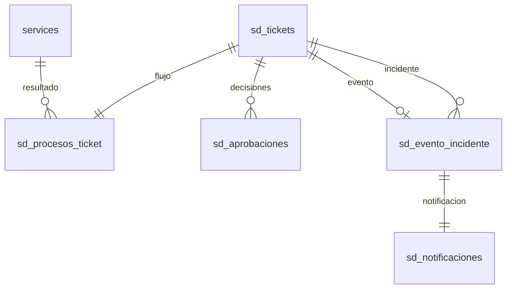

# Siete procesos de Service Desk

Las etapas, permisos y evidencias se verifican en Python. React presenta los formularios y las etapas siguientes; enviar otra etapa directamente a la API no omite las reglas. El estado común (`abierto`, `en_atencion`, `resuelto`, `cerrado`) permite buscar tickets de cualquier proceso; `flujo.estado` conserva su etapa específica.

## Transiciones

| Proceso | Recorrido permitido | Condiciones principales |
|---|---|---|
| Nuevos servicios | solicitud → analisis → pendiente_aprobacion → aprobado → implementacion → validacion → resuelto → cerrado | Necesidad, viabilidad y plan; decisión independiente; crear o vincular servicio; evidencia de implementación y validación. |
| Cambios | solicitud → evaluacion → pendiente_aprobacion → aprobado → planificacion → ejecucion → validacion → resuelto → cerrado | Impacto, riesgo, CI, planes de pruebas y reversión; aprobación del ciclo actual; fecha programada; resultados de ejecución y pruebas; validación. |
| Incidentes | registro → clasificacion → diagnostico → atencion → recuperado → resuelto → cerrado | I0–I6 y condición/duración; diagnóstico; evidencia y duración real de recuperación; solución. |
| Eventos | registro → clasificacion → evaluacion → respondido → resuelto → cerrado | E0–E3; evaluación para E1–E3; E2/E3 deben generar o vincular un incidente. |
| Problemas | registro → investigacion → error_conocido → solucion_definitiva → resuelto → cerrado | Incidentes vinculados, causa raíz; solución temporal para error conocido; solución definitiva y cambio correctivo resuelto. |
| Accesos | solicitud → validacion → pendiente_aprobacion → aprobado → provision → verificacion → resuelto → cerrado | Beneficiario activo, recurso, permiso, acción de provisión/revocación y validación; aprobación independiente del beneficiario; evidencia de provisión y verificación. |
| Servicios de tecnología | solicitud → validacion → asignacion → cumplimiento → confirmacion → resuelto → cerrado | Servicio existente activo, solicitud validada y asignada, evidencia de cumplimiento; confirmación del solicitante. |

Problemas permite pasar de investigación directamente a solución definitiva cuando no necesita registrar un error conocido. Los tres procesos con aprobación permiten `pendiente_aprobacion → rechazado → cerrado`. La aprobación se ejecuta exclusivamente por `/aprobaciones`; la ruta de transiciones rechaza avanzar directamente a aprobado/rechazado.

Antes de avanzar se requiere un responsable asignado y estado común en atención. Transferir entre colas del mismo proceso conserva la etapa y libera al responsable; debe tomarse nuevamente. El cierre conserva los controles de cola. Desde resuelto o cerrado, reabrir inicia otro ciclo, libera responsable, elimina resultados de ejecución/validación y exige otra aprobación. El servicio producido y la correlación evento/incidente se conservan para evitar duplicados.

## Aprobaciones, autorización e historial

Se exige rol aprobador o administrador **y** permiso aprobar en la cola, además de sesión activa. Creador, solicitante y beneficiario no pueden aprobar su propio trámite. Una restricción única impide dos decisiones en el mismo ciclo. Las aprobaciones antiguas de la base común no autorizan procesos nuevos.

Los datos sometidos a aprobación y los metadatos del ticket quedan congelados desde que se solicita la decisión. Para corregirlos después de terminar el ciclo se reabre. El rol consulta permanece de lectura aun teniendo roles adicionales o permisos de cola. El solicitante confirma su propia solicitud de tecnología mediante una operación específica; un agente no puede falsificar esa confirmación en los datos.

Cada modificación y transición guarda actor, fecha, valores anteriores/nuevos y motivo en la bitácora. Las escrituras comparten transacción PostgreSQL; la generación de incidentes, sus CI, vínculo, registro de correlación y notificación se confirman juntas.

## Decisiones funcionales del proyecto

- La clasificación CMDB, organización y relaciones técnicas siguen separadas como describe [MODELO.md](MODELO.md). Los siete procesos son tipos de cola y de flujo, no clases de CI.
- El nuevo servicio conserva el servicio de contexto del ticket y registra el resultado por separado en `servicio_resultado_id`. Puede vincularse explícitamente un servicio activo o crearse usando las validaciones del catálogo original. El código único impide duplicarlo. Repetir la publicación del mismo código/nombre/nivel reutiliza el registro; datos incompatibles exigen una selección explícita.
- Un evento tiene como máximo una correlación persistente a un incidente. Dos llamadas simultáneas se serializan dentro de la transacción y devuelven el mismo incidente. Varios eventos pueden vincularse explícitamente al mismo incidente del mismo servicio; no se deduce una coincidencia solo por el título. E0 registra, E1 evalúa, E2/E3 generan o vinculan. E3 no significa automáticamente I6: la seguridad se diagnostica en el incidente.
- La diapositiva 16 de `Service Desk.pptx (1).pdf` aporta I0–I6 y duraciones de referencia. El intervalo entre una semana y un mes queda sin cubrir en esa fuente; el proyecto usa I5 para toda duración mayor a 168 horas. I1 ≤3 h, I2 ≤8 h, I3 ≤48 h, I4 ≤168 h. I6 corresponde a seguridad e I0 a ausencia de interrupción/degradación. Una categoría que difiera de la sugerencia requiere justificación; I0 e I6 conservan sus restricciones. La redundancia real es un dato independiente que puede ser desconocido. Tras registrar el diagnóstico se congela la clasificación hasta una reapertura.
- Prioridades del proyecto: I0=4, I1/I2=3, I3–I6=1. E3 inicia el incidente con prioridad 1 y E2 conserva la del evento; su clasificación posterior determina la prioridad definitiva.
- La programación de cambios registra una fecha, sin ejecutar comandos ni esperar automáticamente al horario. Las pruebas, reversión, diagnóstico y cumplimiento son evidencias registradas por personas; el sistema valida su presencia y autorización, no ejecuta cambios reales en infraestructura.
- Los tickets previos conservan su estado común. Los ya resueltos/cerrados se migran a la etapa terminal correspondiente; al reabrirse deben completar las reglas nuevas. Los tickets activos empiezan en la etapa inicial con datos pendientes. No se inventan evidencias retroactivas.

## API y persistencia

Además de las rutas comunes de tickets:

| Método/ruta bajo `/api/v1/desk/tickets/{id}` | Uso |
|---|---|
| PATCH `/proceso/datos` | `{datos, motivo}`; campos estrictos según proceso. |
| POST `/proceso/transiciones` | `{estado, motivo}`; valida recorrido y evidencias. |
| POST `/aprobaciones` | `{aprobado, motivo}`; decisión del ciclo actual. |
| POST `/proceso/servicio` | `{servicio_id, motivo}` o `{nuevo, motivo}`; publicación aprobada. |
| POST `/proceso/incidente` | Correlación idempotente E2/E3. |
| POST `/proceso/confirmacion` | `{texto}`; confirmación del solicitante. |

`GET` del ticket incluye `flujo`, datos, versión, servicio resultante y etapas siguientes. La ruta común `/estado` delega en las mismas reglas y no permite resolver con solo una cadena de texto.

La migración `005_procesos.sql` agrega `sd_procesos_ticket`, versión de aprobaciones, `sd_evento_incidente` y `sd_notificaciones`; amplía los vínculos tipados. Las migraciones anteriores no se modifican. Repositorios contienen SQL, servicios contienen reglas, controladores convierten errores en respuestas HTTP.

| Entidad/campo | Diccionario |
|---|---|
| `sd_procesos_ticket.ticket_id` | PK/FK del ticket; creada en la transacción de alta. La consulta no escribe; ante un registro heredado incompleto devuelve una representación inicial de lectura. |
| `estado`, `datos` | Etapa específica y JSONB validado por el esquema de ese proceso; los atributos están enumerados en `process_schema.py`. |
| `version`, `updated_at` | Ciclo positivo y última modificación; reabrir incrementa el ciclo. |
| `servicio_resultado_id` | FK opcional al catálogo; resultado de nuevos servicios, independiente del contexto original. |
| `sd_aprobaciones.version_proceso` | Ciclo aprobado/rechazado; único por ticket/ciclo. Nulo para decisiones anteriores a la migración. |
| `sd_evento_incidente` | Evento PK/FK, incidente FK, actor FK y fecha; una correlación por evento. |
| `sd_notificaciones` | ID, evento único FK, incidente FK, mensaje y fecha; registro persistente interno, sin envío de correo. |
| `sd_ticket_vinculos.tipo` | Añade `evento_incidente`; `incidente_problema` y `problema_cambio` verifican los tipos de sus extremos. |

## Validación reproducible

`docker compose -p catalogo-procesos-tests -f compose.test.yaml up --build --abort-on-container-exit --exit-code-from backend-tests`

La suite incorpora `tests/integration/test_processes.py`: recorridos completos, evidencias faltantes, saltos rechazados, aprobación vigente tras reapertura, datos congelados, I0–I6, E0–E3, correlación concurrente, vínculos correctos, creación de catálogo idempotente, beneficiario que intenta aprobar y confirmación reservada al solicitante. Conserva las pruebas de autenticación, catálogo, importación, CMDB y base Service Desk.

Resultado verificado: [40 pruebas de backend, 11 E2E y persistencia](evidencias/PROCESOS-2026-10-28.md).

## Cierre de auditoría

La ficha del evento muestra sus notificaciones persistentes (mensaje y fecha).
El enlace al incidente solo se ofrece si el actor puede consultarlo en el ámbito
actual. La repetición no crea otra notificación. Una vez correlacionado, el
servicio y los CI del evento no se pueden sustituir, para conservar la coherencia
con el incidente asociado. El título y otros metadatos siguen sujetos a las
validaciones generales. Evidencia y regresiones: [AUDITORIA](AUDITORIA.md).
