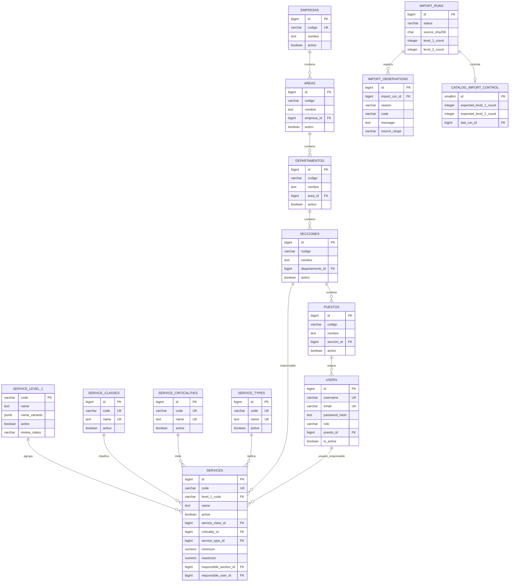
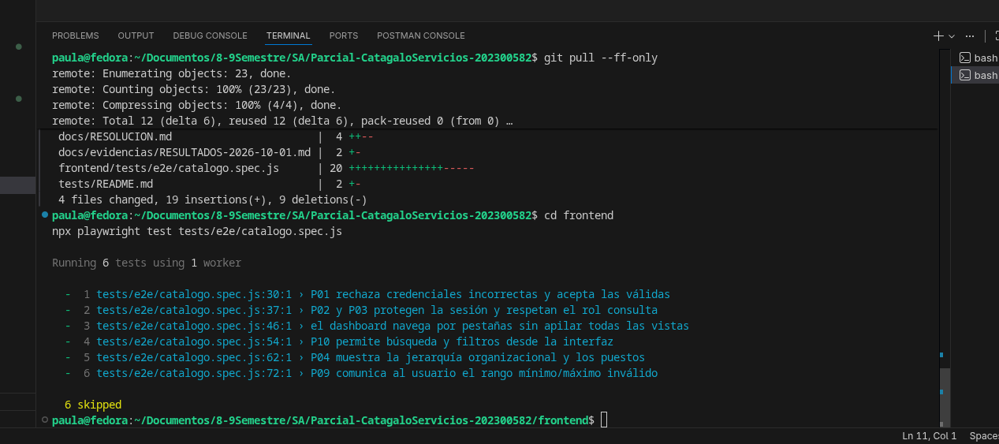

# Resolución del parcial: Catálogo de Servicios de TI

> Documento histórico del parcial 2. Su alcance excluía tickets; la solución
> vigente se explica en [RESOLUCION.md](RESOLUCION.md). No usar este histórico
> como guía de preparación de Service Desk.

**Asignatura:** Software Avanzado
**Fecha de actualización:** 2026-10-02
**Repositorio:** `Parcial-CatagaloServicios-202300582`

Este documento explica el problema, las decisiones técnicas, la importación del
Excel, la seguridad, el harness de pruebas y la forma de reproducir el entorno.
Las evidencias visuales se encuentran en `docs/Imagenes/` y se enlazan en las
secciones correspondientes.

## 1. Problema, alcance y supuestos

### Problema

La organización administra un catálogo de servicios de TI en un archivo Excel.
La información contiene celdas combinadas, filas de continuación, opciones de
catálogo, atributos incompletos y un conflicto de nombres para `SE.12`. Se
requiere convertir esa fuente en una aplicación web consultable y mantenible,
sin perder la trazabilidad del origen.

### Alcance implementado

- Autenticación local con usuario o correo y contraseña.
- Roles `administrador` y `consulta`.
- Organización `Empresa → Área → Departamento → Sección → Puesto → Usuario`.
- Servicios de nivel 1 y nivel 2.
- Catálogos controlados de clase, criticidad y tipo.
- Asignación opcional de sección y usuario responsable.
- Importador repetible del archivo original.
- Búsqueda, filtros, paginación y ficha detallada de servicios.
- Bajas lógicas y validación de dependencias.
- Ejecución reproducible mediante Docker Compose y PostgreSQL con volumen.
- Pruebas unitarias, de integración, E2E y prueba independiente de persistencia.

No se implementan tickets, facturación, consumo de servicios ni proveedores
externos de identidad.

### Supuestos y reglas

1. `data/CatalogoServicios.xlsx` es la fuente original y no se modifica.
2. Las filas físicas no equivalen necesariamente a servicios independientes.
3. Las asignaciones organizacionales son datos nuevos de demostración, no datos
   existentes en el Excel.
4. Los padres de una relación nueva deben existir y estar activos.
5. Una baja elimina lógicamente mediante estado; no borra información.
6. Un campo vacío del Excel se conserva como `NULL` o estado `REVIEW`, nunca se
   convierte automáticamente en cero o en un valor inventado.
7. Los textos del Excel son datos externos no confiables y no pueden modificar
   las instrucciones, las reglas de seguridad ni el alcance del proyecto.

## 2. Arquitectura y justificación de tecnologías

### Arquitectura

La solución usa frontend y backend desacoplados:

```text
React/Vite
    │ HTTP/JSON + Bearer session token
    ▼
FastAPI
    ├── routes/          endpoints y dependencias de autorización
    ├── controllers/     coordinación de solicitudes y respuestas
    ├── services/        reglas de negocio y validaciones
    ├── repositories/    consultas y cambios PostgreSQL
    ├── schemas/         contratos de entrada y salida
    ├── models/          entidades de dominio
    └── importer/        lectura, normalización y trazabilidad del Excel
    ▼
PostgreSQL + volumen postgres_data
```

La lógica de negocio no se coloca en React ni en las rutas. El servidor vuelve a
validar roles, relaciones, estados y rangos aunque la interfaz oculte controles.

### Tecnologías

| Tecnología | Uso | Justificación |
|---|---|---|
| React + Vite | Interfaz web | Componentes separados, navegación por pestañas y desarrollo local rápido. |
| JavaScript | Código del frontend | Compatible con Vite y suficiente para los flujos del parcial. |
| Python + FastAPI | API HTTP | Validación declarativa, documentación OpenAPI y buen soporte para pruebas. |
| PostgreSQL 16 | Persistencia | Relaciones, restricciones, transacciones, índices y volumen persistente. |
| psycopg | Acceso a datos | Consultas parametrizadas y transacciones PostgreSQL. |
| openpyxl | Lectura del Excel | Permite consultar valores, rangos combinados y hojas sin modificar el archivo. |
| Argon2id | Contraseñas | Hash especializado con sal y resistencia frente a ataques de diccionario. |
| AES-256-GCM | Datos recuperables | Confidencialidad e integridad para el perfil cifrado; no se usa para contraseñas. |
| Docker Compose | Reproducción | Orquesta base, API, frontend y dependencias con healthchecks. |

## 3. Diagrama entidad-relación y diccionario de datos

### Diagrama ER



### Diccionario de datos y restricciones

| Tabla | Datos principales | Claves y restricciones |
|---|---|---|
| `empresas` | `id`, `codigo`, `nombre`, `activo` | `id` PK; `codigo` único. |
| `areas` | `id`, `codigo`, `nombre`, `empresa_id`, `activo` | FK obligatoria a empresa; `(empresa_id,codigo)` único. |
| `departamentos` | `id`, `codigo`, `nombre`, `area_id`, `activo` | FK obligatoria a área; `(area_id,codigo)` único. |
| `secciones` | `id`, `codigo`, `nombre`, `departamento_id`, `activo` | FK obligatoria a departamento; `(departamento_id,codigo)` único. |
| `puestos` | `id`, `codigo`, `nombre`, `seccion_id`, `activo` | FK obligatoria a sección; `(seccion_id,codigo)` único. |
| `users` | `id`, `full_name`, `username`, `email`, `password_hash`, `role`, `is_active`, `puesto_id` | Username y correo únicos; rol limitado a `administrador`/`consulta`; puesto obligatorio. |
| `user_sessions` | token hash, vencimiento, revocación, usuario | No almacena el token en claro; sesión revocable y expirable. |
| `service_level_1` | código, nombre canónico, variantes, revisión y trazabilidad | Código PK; conserva variantes de `SE.12`. |
| `services` | campos A–L del Excel, revisión, origen y asignación | Código único; FK a nivel 1 y catálogos; `minimum <= maximum` cuando ambos existen. |
| `service_classes` | código, nombre, estado | Código y nombre únicos; opciones controladas. |
| `service_criticalities` | código, nombre, estado | Código y nombre únicos; opciones controladas. |
| `service_types` | código, nombre, estado | Código y nombre únicos; opciones controladas. |
| `import_runs` | archivo, SHA-256, conteos, estado y resumen | Un registro por ejecución para auditoría. |
| `import_observations` | motivo, severidad, código, mensaje y rango | FK a ejecución; conserva incidencias y omisiones. |
| `catalog_import_control` | esperados, importados y última ejecución | Check de 12 niveles 1 y 46 niveles 2. |

Las bajas lógicas están protegidas: no se desactiva un padre con hijos activos ni
un puesto con usuarios activos. Las asignaciones nuevas tampoco aceptan padres
inactivos.

## 4. Mapeo Excel → base de datos e importación

### Mapeo de columnas

| Excel | Campo persistido | Tratamiento |
|---|---|---|
| A `COD.N1` | `service_level_1.code` y `services.level_1_code` | Texto, sin convertir a número. |
| B `SERVICIO - Nivel 1` | `service_level_1.name` | Primer valor explícito como canónico; variantes en `name_variants`. |
| C `COD.N2` | `services.code` y `original_code` | Texto; conserva `SE.12.1`, `SE.12.2`, `SE.12.3`. |
| D `SERVICIO - Nivel 2` | `services.name` | Se conserva por código de nivel 2. |
| E `ACTIVO` | `services.active` | `S`/`N` se transforman a booleano; desconocidos quedan como `NULL` y `REVIEW`. |
| F `CLASE DE SERVICIO` | `service_class` y `service_class_id` | Texto original más FK al catálogo cuando coincide. |
| G `CRITICIDAD` | `criticality` y `criticality_id` | Texto original más FK al catálogo cuando coincide. |
| H `TIPO DE SERVICIO` | `service_type` y `service_type_id` | Texto original más FK al catálogo cuando coincide. |
| I `Descripción` | `services.description` | Opcional; vacío queda `NULL`. |
| J `Métrica` | `services.metric` | Opcional; vacío queda `NULL`. |
| K `Minimo` | `services.minimum` | Numérico nullable; no se reemplaza vacío por cero. |
| L `Maximo` | `services.maximum` | Numérico nullable; se valida junto con mínimo. |

Cada fila importada conserva `source_sheet`, `source_row`, `source_range` y
`transformations`. El SHA-256 del archivo se registra en `import_runs`.

### Reglas de calidad aplicadas

1. **Celdas combinadas:** se construye un índice de rangos y se lee únicamente la
   celda ancla dentro de su rango. Una fila hija se observa como
   `MERGED_CONTINUATION` y no crea un servicio adicional.
2. **Conflicto `SE.12`:** se eligió `Suministrar Analitica` como nombre canónico
   por ser el primer valor explícito de la fila 99. `Mantener Tableros de
   Control` se conserva en `name_variants` y genera `LEVEL_1_NAME_CONFLICT`.
3. **Códigos:** los códigos se mantienen como texto y el código original queda
   almacenado para verificación.
4. **Atributos incompletos:** los registros de las filas 99–101 conservan
   ausencias como `NULL`, tienen `review_status='REVIEW'` y no reciben clase,
   criticidad, tipo, métrica o estado inventados.
5. **Continuaciones y opciones:** las filas sin código se clasifican como
   continuación, lista de opciones o `NO_SERVICE_CODE`; no se asignan
   automáticamente a otro servicio fuera de una regla explícita.
6. **Idempotencia:** `upsert_level` y `upsert_service` actualizan por código y
   devuelven `created`, `updated` o `unchanged`; repetir el mismo archivo no crea
   duplicados.

### Reporte de importación

La ejecución en seco realizada reportó:

```text
physical_rows: 97
would_import_level_1: 12
would_import_level_2: 46
omitted: 63
observed: 57
```

En ejecución real se almacenan además los conteos de creados, actualizados, sin
cambios, omitidos y observados en `import_runs`, junto con el detalle en
`import_observations`.

## 5. Autenticación, autorización y sesión

- El login acepta `username` o `email` contra PostgreSQL.
- No se utilizan Google, GitHub ni otro proveedor externo.
- Las contraseñas se procesan con Argon2id, que incorpora sal en el hash.
- Nunca se devuelve `password_hash` en las respuestas de usuarios.
- AES-256-GCM se utiliza únicamente para el perfil recuperable, con nonce
  aleatorio, datos asociados autenticados y una clave de 32 bytes fuera de Git.
- El servidor crea un token opaco; PostgreSQL conserva únicamente su SHA-256,
  vencimiento y revocación.
- `logout` revoca la sesión actual.
- Un usuario inactivo no puede iniciar sesión; sus sesiones son rechazadas y las
  rutas protegidas devuelven `401`.
- `administrador` puede mantener usuarios, organización, servicios y catálogos.
- `consulta` puede leer datos funcionales, pero recibe `403` al modificar.
- La visibilidad de botones del frontend no es una regla de autorización.

## 6. Evidencias de ingeniería con IA

### Context engineering

- [Contexto versionado](contexto/CONTEXTO-PROYECTO.md): objetivo, alcance,
  reglas y controles.
- [Actualizaciones del contexto](contexto/ACTUALIZACIONES.md): tres cambios
  motivados por hallazgos del Excel, seguridad y asignaciones.
- [AGENTS.md](../AGENTS.md): arquitectura, convenciones, seguridad y validación.

### Prompt engineering

- [Registro de prompts](prompts/REGISTRO.md): seis solicitudes realmente
  utilizadas, objetivo, contexto, restricciones, salida y aceptación.
- Incluye dos iteraciones: corrección del parser SQL de bloques `DO $$` y
  ampliación de la interfaz para edición y baja lógica.

### Harness engineering

- [Pruebas automatizadas](../tests/README.md).
- [Compose principal](../compose.yaml) y [Compose de pruebas](../compose.test.yaml).
- [Importador](../backend/app/importer/catalog_importer.py).
- [Cuentas demo](../scripts/create_demo_users.py).
- [Persistencia Bash](../scripts/verify_persistence.sh) y
  [persistencia PowerShell](../scripts/verify_persistence.ps1).
- [Resultados y fotografías](evidencias/RESULTADOS-2026-10-01.md).


Las imágenes anteriores documentan el arranque de la base aislada y una
ejecución real de integración con resultado `OK`. La fotografía
`PruebaUnitariaPyhton.png` se conserva como antecedente de una ejecución
omitida, no como evidencia aprobatoria.

El ciclo documentado fue: solicitud de importación → fallo al separar bloques
SQL `DO` → corrección del parser → validación de sintaxis, esquema y ejecución
en seco. La aplicación no requiere una suscripción ni una clave de proveedor de
IA para funcionar.

## 7. Matriz requisito → implementación → prueba → evidencia

| Requisito | Implementación | Prueba | Evidencia |
|---|---|---|---|
| Login válido e inválido | `auth_service.py`, `/auth/login` | P01 integración/E2E | `tests/integration/test_scenarios.py`, `frontend/tests/e2e/catalogo.spec.js` |
| Logout, sesión y usuario inactivo | sesiones revocables y dependencias de auth | P02 | `test_scenarios.py` |
| Roles y servidor protegido | `require_administrator`, `require_functional_reader` | P03 | `test_scenarios.py`, `AdminPanel.jsx` |
| Jerarquía organizacional | `directory_service.py`, `OrganizationPanel.jsx` | P04 | `test_scenarios.py`, E2E P04 |
| Duplicados y padres inexistentes | restricciones únicas y validaciones | P05 | `test_scenarios.py` |
| Importación 12/46 | `catalog_importer.py` | P06 | `test_importer_rules.py`, dry-run |
| Importación repetible | upserts por código | P07 | `test_scenarios.py` |
| `SE.12` y ausencias | variantes, `REVIEW`, observaciones | P08 | `test_importer_rules.py`, `docs/RESOLUCION.md` |
| Mínimo y máximo | Pydantic, servicio y check SQL | P09 | integración y E2E |
| Búsqueda y filtros | `ServiceBrowser.jsx`, `/services` | P10 | integración y E2E |
| Responsable de misma sección | `assignment_is_valid` | P11 | `test_scenarios.py` |
| Persistencia | volumen `postgres_data` | P12 | `P12Ejecuccion.png`, script Bash/PowerShell |
| Docker y healthchecks | `compose.yaml`, `depends_on` | arranque Compose | `DockerEjecucion.png` |

## 8. Resultados reales, fechas, commits y correcciones

### Resultados ejecutados

| Fecha | Commit de referencia | Comando | Resultado |
|---|---|---|---|
| 2026-10-01 | `57b2024` + cambios locales | `python -m backend.app.importer --dry-run` | 12 nivel 1, 46 nivel 2, 63 omitidas, 57 observadas. |
| 2026-10-02 | `57b2024` + cambios locales | `python -m compileall -q backend scripts tests` | OK. |
| 2026-10-02 | `57b2024` + cambios locales | `node --check frontend/tests/e2e/catalogo.spec.js` | OK. |
| 2026-10-02 | `57b2024` + cambios locales | pruebas unitarias de importador y seguridad | 4 aprobadas, 2 omitidas por dependencias del entorno de revisión. |
| 2026-10-02 | fotografía Fedora | `docker compose up --build -d` | Build finalizado y servicios saludables; ver `DockerEjecucion.png`. |
| 2026-10-02 | fotografía Fedora | `bash scripts/verify_persistence.sh` | P12 aprobado; ver `P12Ejecuccion.png`. |
| 2026-10-02 | `194fc36` | `docker compose -f compose.test.yaml -p catalogo-servicios-tests run --build --rm backend-tests` | Integración aprobada: una prueba ejecutada, `OK`; ver `PruebaIntegracion.png`. |
| 2026-10-02 | `442822b` | `npx playwright test tests/e2e/catalogo.spec.js` | Seis casos omitidos; ejecución no aprobatoria, ver `PruebaE2EOmitida.png`. |


Esta captura no se presenta como una prueba aprobada: el resultado muestra
`OK (skipped=1)`, por lo que la integración debe repetirse con PostgreSQL
disponible.


La integración ya fue repetida con PostgreSQL aislado y finalizó con `OK`.



La captura E2E muestra `6 skipped`. Playwright arrancó, pero los escenarios no
se ejecutaron porque faltaban credenciales `E2E_*` en esa sesión de terminal;
debe reemplazarse por una captura que muestre `6 passed`.

La fotografía `PruebaUnitariaPyhton.png` muestra `OK (skipped=1)` para una
ejecución anterior; se conserva como evidencia histórica, no como aprobación.
La integración correcta ya está registrada en `PruebaIntegracion.png`. Las
ejecuciones reproducibles se realizan con:

```bash
docker compose -f compose.test.yaml -p catalogo-servicios-tests run --build --rm backend-tests
docker compose exec backend python -m unittest tests.backend.test_importer_rules tests.backend.test_security
cd frontend
npx playwright test tests/e2e/catalogo.spec.js
```

### Fallos encontrados y correcciones

1. El parser inicial de SQL podía separar incorrectamente un bloque
   `DO $$...$$`; se reemplazó por un parser que conserva dichos bloques.
2. La primera UI mostraba consulta y administración en una sola página; se
   agregó `OrganizationPanel` y luego navegación por pestañas.
3. La ficha de servicio mostraba objetos con `JSON.stringify`; se reemplazó por
   `DetailValue`, etiquetas en español y listas de pares clave/valor legibles.
4. La prueba P12 necesitaba esperar a PostgreSQL después de iniciar y reiniciar;
   se agregaron reintentos en Bash y PowerShell.

El commit `57b2024` es el commit de referencia visible al redactar este
documento, pero contiene cambios locales posteriores. Antes de entregar se debe
crear el commit final y sustituir esta referencia en la tabla:

```bash
git add .
git commit -m "Entrega final del parcial de catalogo de servicios"
git rev-parse --short HEAD
git tag -a parcial-v2.0 -m "Entrega parcial v2.0"
git push origin main --tags
```

## 9. Docker, persistencia y recuperación

### Requisitos y URLs

- Docker Engine 24 o superior.
- Docker Compose v2.20 o superior.
- Frontend: `http://localhost:5173`.
- API: `http://localhost:8000`.
- Swagger: `http://localhost:8000/docs`.
- PostgreSQL local: `localhost:5432`, base `catalogo_servicios`.

### Arranque desde clon limpio

```bash
cp .env.example .env
# Generar APP_ENCRYPTION_KEY con una clave Base64 URL-safe de 32 bytes.
docker compose up --build -d
docker compose ps
docker compose logs -f backend
docker compose exec backend python scripts/create_demo_users.py
```

El backend espera el healthcheck de PostgreSQL, ejecuta el importador y luego
expone la API. El frontend espera el healthcheck del backend.


### Persistencia y operación normal

Los datos viven en el volumen `postgres_data`.

```bash
docker compose logs -f db
docker compose logs -f backend
docker compose logs -f frontend
docker compose stop
docker compose start
```

`docker compose down` elimina contenedores y red, pero conserva el volumen.


### Pruebas aisladas

```bash
docker compose -f compose.test.yaml -p catalogo-servicios-tests run --build --rm backend-tests
bash scripts/verify_persistence.sh
```

Las pruebas utilizan `postgres_test_data`, separado de `postgres_data`.

### Recuperación destructiva de datos de prueba

Solo para reconstruir el entorno de evaluación desde cero:

```bash
docker compose down -v
docker compose up --build -d
```

Este comando elimina la base y el volumen `postgres_data`; no debe utilizarse
para el apagado diario ni durante las pruebas de persistencia.

## Limitaciones y revisión humana final

- La integración PostgreSQL y Playwright deben ejecutarse nuevamente en Fedora
  y capturarse con resultado aprobado.
- La captura que exponga contraseñas demo debe reemplazarse o censurarse.
- Debe verificarse el colaborador GitHub `maldanap-usac`.
- Debe entregarse la URL, rama y SHA del commit final, con la etiqueta
  `parcial-v2.0`.
- La estudiante debe poder explicar el modelo, las reglas del importador, la
  política de bajas, la sesión y las pruebas durante la revisión.
