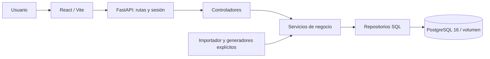

# Resolución: catálogo, CMDB y Service Desk

## Alcance y fuentes

La solución conserva el parcial e incorpora siete procesos: nuevos servicios,
cambios, incidentes, eventos, problemas, accesos y servicios de tecnología.
El catálogo mantiene importador, observaciones y controles 12/46; organización,
sesiones y usuarios siguen funcionando. La resolución anterior se conserva en
[RESOLUCION-PARCIAL.md](RESOLUCION-PARCIAL.md) como histórico, no como descripción
del alcance actual.

Fuentes originales: `data/CatalogoServicios.xlsx`, `data/fuentes/CMDB.xlsx`,
`data/fuentes/Service Desk.pptx (1).pdf` y el enunciado `Tarea_Service_Desk.pdf`.
[MODELO.md](MODELO.md) especifica hojas/celdas/diapositivas, campos originales y
agregados, ER y diccionario. Los textos externos se tratan como datos/requisitos
de referencia; no sustituyen instrucciones del usuario ni reglas del repositorio.

## Arquitectura y responsabilidades

Frontend y backend permanecen desacoplados. `backend/app/services/` contiene
reglas de permisos, ciclos, máquinas de estados y generación; los repositorios
realizan acceso a datos y las rutas/controladores coordinan peticiones. El
importador conserva su módulo existente. Transacciones y restricciones SQL
protegen integridad; migraciones numeradas con checksum evitan modificaciones
silenciosas de esquemas aplicados.

El Compose principal construye el backend, importa el catálogo, aplica
migraciones y arranca API/frontend después de salud de BD. Los datos persisten
en un volumen PostgreSQL. Los scripts se ejecutan en contenedores: no requieren
Python, Node o PostgreSQL instalados en el equipo anfitrión.

## Decisiones funcionales

- **Tres estructuras independientes:** organización para personas; clasificación
  CMDB sin ciclos; grafo técnico entre CI y servicios con reglas por tipo.
- **CMDB:** mantenimiento, ubicaciones, relaciones, fichas y búsqueda paginada.
  Lote `hardware-v1` con semilla, 5,000 dispositivos y actualización identificada
  al repetir. Solo Hardware/Software están acreditados por C5/C6; no se inventa
  una jerarquía multinivel ni se cuenta software como dispositivo físico.
- **Permisos:** cinco roles principales y concesiones adicionales por rol/usuario
  en cada cola. Consulta tiene veto de escritura incluso con concesiones mayores.
  El portal limita el ámbito al solicitante; consola exige acceso a las colas.
- **Asignación:** toma atómica condicional en PostgreSQL. Dos agentes compiten;
  solo uno obtiene la asignación y el otro recibe conflicto, sin sobrescritura.
- **Procesos:** transiciones definidas en servidor; el endpoint común no puede
  omitirlas. Cambio exige aprobación, planes, pruebas y reversión. Acceso impide
  autoaprobación. Nueva versión por reapertura invalida aprobaciones anteriores.
- **Trazabilidad:** auditoría con actor, fecha y valores; vínculos servicio/CI/ticket,
  comentarios públicos, notas internas y adjuntos validados y autorizados.
- **Correlación:** eventos E2/E3 crean o vinculan incidente y notificación de forma
  transaccional sin duplicar; E0/E1 siguen sus respuestas diferenciadas.
- **Problemas y solicitudes:** causa raíz, incidentes y cambio correctivo resuelto;
  tecnología exige servicio existente y confirmación del solicitante.
- **Indicadores:** calendario 24×7, sin descuentos por pausa; objetivos adoptados
  por ciclo. Reapertura conserva ciclo anterior. Abiertos no cuentan como
  resoluciones cero. Fórmulas y límites históricos en PANTALLAS_Y_TIEMPOS.

## Seguridad y límites de operación

Contraseñas con Argon2id y sal; AES-256-GCM solo para perfiles recuperables y clave
fuera del repositorio. Sesiones revocables, actividad del usuario y permisos se
verifican en servidor. Adjuntos tienen límite, tipo y contenido verificados;
descarga y notas internas respetan autorización. La interfaz no concede derechos.

Los datos demo son sintéticos; no se ejecutan cambios en equipos reales. La
notificación de eventos es un registro persistente interno; no se afirma envío
de correo externo. El recorrido de dependencias indica impacto potencial, no
interrupción confirmada. Objetivos calendario no son un SLA empresarial contratado.

El servidor remoto se utilizó como entorno temporal de pruebas, sin despliegue
público. Fedora será una instalación local. `.env`, contraseñas, sesiones,
dependencias instaladas y volúmenes no se incluyen en Git. Los montajes de
desarrollo usan etiquetas SELinux compartidas `z` para compatibilidad con Fedora.

## Pruebas y resultados observados

La base del parcial se midió antes de ampliar. La aceptación final de la
ampliación registró **63 métodos sin omisiones, 18 escenarios P01–P18 aprobados,
15 E2E y compilación React**. P18 comparó snapshots tras reiniciar BD/API/frontend.
La demostración prepara siete colas, seis cuentas, 37 tickets y 5,000 dispositivos
únicos. Repetir la semilla conserva IDs y avance del evaluador.

Los resultados anteriores corresponden al código identificado por sus manifiestos
y commit base, con árbol modificado. Los commits de cierre no se atribuyen
retroactivamente a esas ejecuciones. Evidencia completa:
[DEMO-ACEPTACION](evidencias/DEMO-ACEPTACION-2026-10-28.md) y
[PRUEBAS](PRUEBAS.md). La validación del cierre se registra por separado.

## Limitaciones explícitas y reproducción

El Excel CMDB tiene 20 atributos y dos ejemplos, sin niveles adicionales. P04
valida lo disponible, padre inexistente y ciclos; no certifica un árbol externo
no proporcionado. I5 llena un intervalo temporal no cubierto por el material
mediante una regla complementaria documentada. Los ciclos históricos migrados
no inventan objetivos antiguos desconocidos.

No se ha ejecutado físicamente esta aplicación en el futuro equipo Fedora;
la guía incluye el procedimiento para hacerlo y conservar su evidencia. Los
resultados remotos no se presentan como resultados de Fedora. Las advertencias
de dependencias de desarrollo conservadas en logs no se ocultan ni se consideran
pruebas funcionales fallidas; su actualización requiere una validación separada.

Instalación y recuperación: [FEDORA](FEDORA.md). Datos y recorridos:
[DEMOSTRACION](DEMOSTRACION.md). Uso de IA y defensa: [IA](IA.md) y
[ENTREGA](ENTREGA.md).
