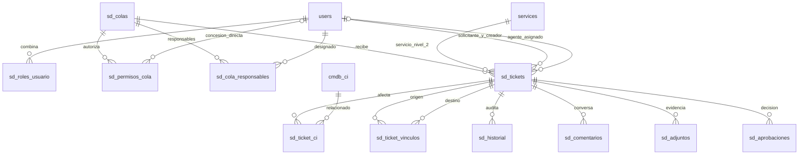

# Base común de tickets, colas y permisos

Esta etapa implementa la base compartida del Service Desk. Las siete clases de
proceso pueden tener colas diferentes, pero sus flujos especializados todavía
no se implementan aquí. El flujo común no acredita las rutas completas de los
siete procesos exigidas por la tarea.

## Puesta en marcha

```bash
docker compose up --build -d
docker compose exec backend python scripts/create_demo_users.py
docker compose exec backend python scripts/create_desk_demo.py
```

El arranque aplica `003_service_desk.sql` y `004_ticket_resolucion.sql` después
de las migraciones de CMDB. Sirve también con un volumen ya existente. Se conservan
autenticación local, sesiones revocables, contraseñas Argon2id, catálogo 12/46
y estructura organizacional. No se requiere ninguna variable de entorno nueva.

El primer comando de cuentas prepara administrador y consulta; el segundo
prepara `demo-solicitante`, `demo-agente1`, `demo-agente2`, `demo-aprobador` y
siete colas `DEMO-*`, una por proceso. Las contraseñas aleatorias se imprimen
solo en la consola; no guardarlas en Git. Repetir el script renueva las cuatro
credenciales y sus sesiones, conserva las colas existentes y no sobrescribe
sus permisos. Ese script básico no crea tickets; para el conjunto completo
de 37 tickets y 5,000 dispositivos use [DEMOSTRACION.md](DEMOSTRACION.md).

En la pestaña **Service Desk** están el portal de creación/consulta, la consola
de agentes y la administración de colas. Los usuarios existentes se mantienen
desde Organización/Usuarios; el selector de rol principal admite los cinco
roles y el panel Service Desk permite combinar los tres roles nuevos.

## Roles y política de permisos

`users.role` sigue siendo el rol principal; se amplía su restricción a
administrador, consulta, solicitante, agente y aprobador. La tabla
`sd_roles_usuario` agrega roles solicitante/agente/aprobador sin eliminar el
principal. Cada operación vuelve a leer el usuario activo y sus roles desde
PostgreSQL, además de validar la sesión en el servidor.

| Rol | Capacidad |
|---|---|
| Administrador | Configuración global, roles y operaciones de atención; no puede autoaprobar una solicitud propia |
| Consulta | Solo lectura de tickets propios o de colas con permiso consultar; no crea tickets, comenta, adjunta ni modifica configuración |
| Solicitante | Crea para sí mismo, ve sus tickets y contribuye con comentarios/adjuntos públicos; no ve notas internas |
| Agente | Requiere permisos de cola para consultar, atender, asignar, transferir o escalar |
| Aprobador | Requiere consultar/aprobar en la cola; registra decisiones sin poder autoaprobar como solicitante o creador |

**Consulta tiene precedencia de solo lectura:** si el rol principal es
consulta, agregarle roles adicionales o concederle atención/aprobación/
administración por usuario o rol en una cola no permite escribir. Cambiar el
rol principal desde administración es una acción explícita distinta de
pertenecer a una cola.

Las concesiones de `sd_permisos_cola` se asignan a un rol o a un usuario,
exactamente uno por fila; ambos tipos pueden coexistir en una cola. Son
permisos separados: `consultar`, `atender`, `transferir`, `aprobar`,
`administrar`. No se infiere atención de una concesión de consulta.

Los responsables configurados de una cola son metadatos de responsabilidad,
no una concesión implícita de acceso. El administrador global puede operar
cualquier cola. La administración delegada necesita permiso `administrar` en
esa cola, y no concede administración de cuentas ni roles globales.

Las colas activas pueden verse como destinos para registrar solicitudes. Esto
no permite leer sus tickets: el listado y el detalle restringen el acceso al
solicitante, administrador o miembros con `consultar`. Un agente objetivo de
asignación debe estar activo, tener rol agente (o administrador) y permisos de
consulta y atención en la cola.

## Datos y relaciones



| Entidad | Campos, claves y restricciones principales |
|---|---|
| `sd_colas` | PK id, código único, nombre, descripción, exactamente un proceso, activo, soporte 0–4, ordenamiento fijo prioridad/antigüedad y objetivos configurables positivos en minutos |
| `sd_roles_usuario` | PK `(usuario_id,rol)`, FK a usuario; roles adicionales limitados a los tres nuevos |
| `sd_permisos_cola` | FK cola/usuario, rol o usuario excluyentes, permiso controlado; sujeto/permiso único por cola |
| `sd_cola_responsables` | PK compuesta cola/usuario; usuarios existentes y activos al configurar |
| `sd_tickets` | PK id y número generado `SD-00000001` único; título, descripción, solicitante, creador, servicio, cola, responsable opcional, estado, prioridad 1–4, impacto, urgencia, canal, motivo sin CI, resolución y fechas |
| `sd_ticket_ci` | PK ticket/CI; admite varios CI activos al asociar, o ninguno si se justifica |
| `sd_ticket_vinculos` | FK origen/destino, tipo y unicidad; sin autorrelaciones; `relacionado` normaliza los dos IDs para evitar duplicado inverso |
| `sd_historial` | PK id, ticket/cola opcionales, actor, fecha, acción, antes/después JSON, visibilidad interna; no existen rutas de edición/borrado |
| `sd_comentarios` | Ticket, actor, texto, fecha e interno; sin edición destructiva |
| `sd_adjuntos` | Ticket, actor, nombre, MIME, bytes, SHA-256, fecha e interno; contenidos persistidos en PostgreSQL |
| `sd_aprobaciones` | Ticket, aprobador, resultado, motivo y fecha; registro de decisión, aún no motor de flujos especializados |

El nivel 1 del ticket se deriva de `services.level_1_code`. Su proceso y tipo
se derivan de la cola; cambiar el proceso de una cola que ya tiene tickets se
rechaza, incluso si están cerrados. El mapeo de los siete procesos a seis tipos
es el documentado en `MODELO.md`, diapositiva 14; nuevos servicios es requisición.

Los números son únicos pero pueden tener saltos por transacciones revertidas.
No se eliminan tickets ni historial desde la API. Los vínculos con otros
tickets requieren acceso de atención a ambos destinos y el detalle oculta
vínculos cuyo otro ticket ya no sea consultable por el actor.

## Asignación, transferencias y concurrencia

La política inicial es **manual**: tomar o asignar un agente autorizado.
El listado ordena por prioridad ascendente (1 más alta, 4 más baja), creación
ascendente e ID como desempate. El usuario puede filtrar cola, proceso,
servicio, número/título, estado, prioridad, responsable y fechas; página máxima
de 100 filas. Los filtros de la interfaz convierten hora local del navegador a
UTC; en API una fecha sin zona se interpreta como UTC.

La toma utiliza un UPDATE condicional de PostgreSQL:

```sql
UPDATE sd_tickets
SET responsable_id = :actor, estado = 'en_atencion', ...
WHERE id = :ticket AND responsable_id IS NULL AND estado = 'abierto'
RETURNING *;
```

La modificación y la bitácora comparten transacción. Solo un agente recibe el
registro actualizado; el segundo obtiene 409 y no genera otra toma. Las
operaciones de configuración/atención se coordinan además con un bloqueo
transaccional común de Service Desk. Esto prioriza integridad; no se ha medido
capacidad de atención de muchas colas concurrentes.

Transferir exige permiso en origen, consulta en destino, motivo y otra cola
activa del mismo proceso. Escalar exige además nivel superior. Se libera el
responsable anterior y el ticket queda abierto en la cola destino, sin agente
inválido heredado. Se conserva primera atención y se auditan los valores
anteriores, nuevos y motivo. Una transferencia entre procesos se rechaza; para
relacionar incidentes, problemas y cambios se usan vínculos entre tickets.

Una cola con tickets no cerrados no puede desactivarse. Un usuario con tickets
asignados no cerrados no puede desactivarse ni cambiar su rol principal: un
trigger protege también las rutas antiguas de administración. Revocar roles
adicionales o permisos que dejarían un agente asignado sin autorización se
rechaza y revierte la transacción. Primero reasignar/transferir o cerrar.

## Flujo común y colaboración

El flujo común permite abierto → en atención mediante toma/asignación; luego
en atención → resuelto → cerrado. Se requiere resolución para resolver/cerrar.
Resuelto puede volver a en atención; cerrado puede reabrirse a abierto con
motivo y permiso de atención. La reapertura libera el agente y borra resolución
y fechas de resolución/cierre actuales, conservando sus valores en bitácora.
Los campos del ticket pueden editarse por atención mientras sigue abierto o
en atención, con motivo obligatorio. El solicitante agrega comentarios, no
altera clasificación ni asignaciones.

Los comentarios públicos son visibles al solicitante y lectores autorizados.
Las notas internas, sus entradas de historial y sus adjuntos solo se entregan
a administrador o agentes con atención en la cola actual. No se filtran solo
en React: PostgreSQL/servicio omiten contenido interno en las respuestas. El
rol aprobador por sí solo no concede acceso a notas internas.

Adjuntos: máximo 5 MiB, texto UTF-8 `.txt`, PDF, PNG o JPEG. Se valida tamaño,
extensión, MIME y firma inicial; se rechazan nombres con rutas, saltos de línea o NUL.
Los originales se almacenan como bytes con hash, no en un directorio público.
La descarga requiere sesión y permiso actual sobre ticket/visibilidad; usa
`Content-Disposition: attachment`, `nosniff` y `Cache-Control: no-store`.
Los adjuntos no se ejecutan ni se descargan por enlaces del Excel. La validación
de firma no constituye análisis antivirus ni validación completa del formato.

## API

Prefijo `/api/v1/desk`, autenticación Bearer en todas las rutas. PUT reemplaza
el recurso o la colección indicada. Sin permiso se devuelve 403; referencia
desconocida 404; conflicto de negocio/concurrencia 409; dato inválido 422;
adjunto sobre el límite 413.

| Ruta | Métodos/operación |
|---|---|
| `/me`, `/opciones` | GET contexto actual y catálogos del módulo |
| `/usuarios/{id}/roles` | GET/PUT roles adicionales, solo administrador |
| `/colas` | GET disponibles; POST creación administrativa |
| `/colas/{id}` | PUT mantenimiento; DELETE baja lógica |
| `/colas/{id}/permisos` | PUT reemplaza concesiones con validación de asignaciones |
| `/colas/{id}/historial` | GET auditoría, administrador de esa cola |
| `/tickets` | GET paginado y filtrado por autorización; POST creación |
| `/tickets/{id}` | GET ficha; PUT metadatos/CI con motivo |
| `/tickets/{id}/tomar` | POST toma atómica |
| `/tickets/{id}/asignar` | POST `usuario_id`, `motivo` |
| `/tickets/{id}/transferir`, `/escalar` | POST `cola_id`, `motivo` |
| `/tickets/{id}/estado` | POST `estado`, `motivo`, `resolucion` cuando corresponda |
| `/tickets/{id}/comentarios` | POST `texto`, `interno` |
| `/tickets/{id}/vinculos` | POST `ticket_id`, `tipo` |
| `/tickets/{id}/aprobaciones` | POST `aprobado`, `motivo`; sin autoaprobación |
| `/tickets/{id}/adjuntos?nombre=archivo.txt&interno=false` | POST cuerpo binario y encabezado MIME, no multipart |
| `/adjuntos/{id}` | GET descarga autorizada |

## Validación

```bash
docker compose -f compose.test.yaml -p catalogo-desk-tests run --build --rm backend-tests
bash scripts/verify_desk_persistence.sh
```

La suite usa una base exclusiva `catalogo_servicios_test`, recrea su esquema y
conserva las pruebas del parcial/CMDB. Nunca apuntarla a una base de evaluación.
El proyecto usa el puerto de pruebas 55432, que debe estar libre. Las pruebas
de interfaz añaden `E2E_REQUESTER_USER/PASSWORD` y `E2E_AGENT_USER/PASSWORD` a las
variables E2E anteriores; requieren los scripts de cuentas/colas demo y un lote
de 5,000 para ejecutar también la regresión CMDB.

Resultados reales y registros: [SERVICE-DESK-2026-10-28.md](evidencias/SERVICE-DESK-2026-10-28.md).
Los siete flujos diferenciados, aprobaciones, evidencias y categorías
E0–E3/I0–I6 se implementan en [PROCESOS.md](PROCESOS.md).
Quedan pendientes los indicadores y automatizaciones adicionales.
Los objetivos de cola se almacenan en minutos calendario; aún no se calculan
cumplimientos, pausas ni SLA en esta base común.
