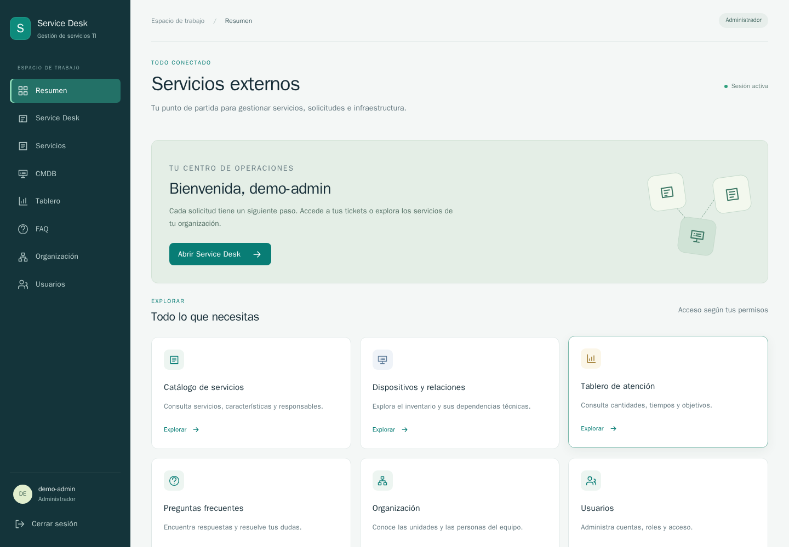

# Frontend mejorado y capturas reales

Fecha del cliente: **28 de octubre de 2026, UTC−06:00**. Capturas UTC:
`2026-10-29T04:56:33.549Z` a `2026-10-29T04:56:44.504Z`.
Código evaluado: `d40a42a702a2c49a3afbd78c34cb6f37acdbe55e`.

## Resultado y alcance

Se mejoraron navegación, acceso, portada, formularios, listas, fichas y tablero.
La revisión visual incluyó acceso, resumen, inventario, consola cargada, permisos,
cambio, problema, evento, tablero y vista móvil. No se cambiaron reglas del backend.

| Verificación | Esperado | Obtenido |
|---|---|---|
| Construcción y arranque Compose | Aplicación y BD saludables | Salida 0; API con estado y base `ok`. |
| Regresiones de navegador y móvil | Flujos conservados, sin omisiones | **16 E2E aprobadas en 17.4 s**, salida 0. |
| Compilación frontend | Sin errores | **43 módulos en 1.76 s**, salida 0. |
| Capturas verificadas por datos visibles | Siete procesos, roles, CMDB, portal, FAQ y tablero | **23 PNG**, índice con fecha/rol/dimensiones y salida 0. |
| Correspondencia de código | Misma copia ejecutada y local | **138 huellas SHA256 idénticas**. |

Es una copia aislada en `/home/servidor/catalogo-frontend-mejora`, Ubuntu del
servidor autorizado. El Compose principal se usó con override de puertos:
frontend `127.0.0.1:15175`, API `127.0.0.1:18002`, PostgreSQL sin puerto publicado.
El entorno no es Fedora y no se presenta como prueba física de ese equipo.

El generador preparó siete colas, seis usuarios, 37 tickets y 5,000 dispositivos.
Las primeras E2E agregaron dos tickets; por eso las capturas de consola/tablero
muestran **39 tickets**, de los cuales 37 pertenecen al lote. La segunda corrida
puede agregar otros dos. No se borraron solicitudes para forzar el total.
La captura del catálogo comprueba 46 resultados. Los tiempos nativos de demo
son sintéticos y no representan rendimiento humano.

## Comandos ejecutados

Desde la raíz de la copia, con `.env` local y un archivo `.e2e.env` privado:

```bash
docker compose -p catalogo-frontend-app -f compose.yaml -f compose.validation.yaml up --build -d --wait
docker compose -p catalogo-frontend-app -f compose.yaml -f compose.validation.yaml exec -T backend python scripts/prepare_demo.py --seed 202300582

docker run --rm --network host --env-file .e2e.env \
  -v "$PWD/frontend:/work:z" \
  -v "$PWD/docs/evidencias/frontend-2026-10-28:/evidence:z" \
  -w /work mcr.microsoft.com/playwright:v1.63.0-noble node scripts/capture-demo.mjs

docker run --rm --network host --env-file .e2e.env \
  -v "$PWD/frontend:/work:z" -w /work \
  mcr.microsoft.com/playwright:v1.63.0-noble npx playwright test --reporter=list

docker compose -p catalogo-frontend-app -f compose.yaml -f compose.validation.yaml exec -T frontend npm run build
```

El script recibe contraseñas por entorno; no se incluyen en las imágenes ni en
el índice. Se utilizaron cuentas y contenidos sintéticos. Datos técnicos y
reproducción: [FRONTEND.md](../FRONTEND.md).

## Galería



| Captura | Rol | Qué muestra |
|---|---|---|
| [01-acceso.png](frontend-2026-10-28/capturas/01-acceso.png) | sin sesión | Acceso con cuenta local; no muestra credenciales. |
| [02-resumen.png](frontend-2026-10-28/capturas/02-resumen.png) | admin | Navegación y accesos a los módulos del sistema. |
| [03-catalogo.png](frontend-2026-10-28/capturas/03-catalogo.png) | admin | Catálogo de 46 servicios de la fuente, filtros y fichas. |
| [04-cmdb.png](frontend-2026-10-28/capturas/04-cmdb.png) | admin | Inventario de 5,000 dispositivos, búsqueda, clasificación y paginación. |
| [05-ficha-ci.png](frontend-2026-10-28/capturas/05-ficha-ci.png) | admin | Atributos originales y técnicos del CI seleccionado. |
| [06-dependencias.png](frontend-2026-10-28/capturas/06-dependencias.png) | admin | Relaciones navegables y servicios potencialmente afectados; no afirma interrupción. |
| [07-colas.png](frontend-2026-10-28/capturas/07-colas.png) | admin | Siete colas, una por proceso, con permisos y objetivos calendario. |
| [08-permisos.png](frontend-2026-10-28/capturas/08-permisos.png) | admin | Permisos por rol o usuario en la cola de cambios. |
| [09-cambio-pendiente.png](frontend-2026-10-28/capturas/09-cambio-pendiente.png) | approver | Cambio pendiente, planes y decisión por un aprobador independiente. |
| [10-consulta.png](frontend-2026-10-28/capturas/10-consulta.png) | consulta | Colas visibles para consulta sin formularios de escritura. |
| [11-consola.png](frontend-2026-10-28/capturas/11-consola.png) | agent | Consola de agente: tickets y filtros de las colas autorizadas. |
| [12-problema.png](frontend-2026-10-28/capturas/12-problema.png) | agent | Problema cerrado con causa raíz, incidentes y cambio correctivo. |
| [13-evento-e3.png](frontend-2026-10-28/capturas/13-evento-e3.png) | agent | Evento E3 respondido y vínculo a un incidente I6. |
| [14-incidente-i6.png](frontend-2026-10-28/capturas/14-incidente-i6.png) | agent | Incidente I6 con diagnóstico, recuperación y solución. |
| [15-portal.png](frontend-2026-10-28/capturas/15-portal.png) | requester | Portal limitado a tickets del solicitante. |
| [16-faq.png](frontend-2026-10-28/capturas/16-faq.png) | requester | Autoservicio con artículo publicado y búsqueda. |
| [17-tablero.png](frontend-2026-10-28/capturas/17-tablero.png) | admin | Cantidades y objetivos de datos sintéticos; puede incluir solicitudes adicionales de las E2E. |
| [18-movil-resumen.png](frontend-2026-10-28/capturas/18-movil-resumen.png) | requester | Portada y navegación en una pantalla de 390 px. |
| [19-movil-portal.png](frontend-2026-10-28/capturas/19-movil-portal.png) | requester | Portal y filtros adaptados al ancho móvil. |
| [20-nuevo-servicio.png](frontend-2026-10-28/capturas/20-nuevo-servicio.png) | agent | Nuevo servicio cerrado mediante vínculo a un servicio existente, sin duplicarlo. |
| [21-acceso.png](frontend-2026-10-28/capturas/21-acceso.png) | approver | Solicitud de acceso, beneficiario y permiso, con aprobación independiente. |
| [22-servicio-tecnologia.png](frontend-2026-10-28/capturas/22-servicio-tecnologia.png) | requester | Solicitud sobre servicio existente con evidencia y confirmación del solicitante. |
| [23-historial.png](frontend-2026-10-28/capturas/23-historial.png) | agent | Auditoría del ticket con actor, fecha y valores anteriores/nuevos. |

## Registros y corrección del capturador

[Índice completo](frontend-2026-10-28/capturas/INDICE.json),
[ejecución](frontend-2026-10-28/ejecucion.json),
[E2E](frontend-2026-10-28/e2e.txt),
[compilación](frontend-2026-10-28/build.txt),
[capturas](frontend-2026-10-28/capturas.txt),
[manifiesto servidor](frontend-2026-10-28/codigo-servidor.json) y
[manifiesto local](frontend-2026-10-28/codigo-local.json).

La primera ejecución del capturador encontró un elemento desconectado al cambiar
rápidamente de ticket y produjo una imagen de consola cargando. Se corrigió para
esperar el título solicitado y los 25 registros de la página; se regeneraron las
imágenes. El registro inicial se conserva en `capturas-inicial.txt`; no se entrega
esa vista incompleta como evidencia final. La segunda ejecución completó 19
imágenes y la definitiva añadió los procesos restantes e historial hasta 23.
Las 16 E2E se repitieron después del último ajuste de texto/renderizado.

No se repite la aceptación backend por este cambio visual: sus 63 métodos y
P01–P18 tienen evidencia previa en [CIERRE](CIERRE-2026-10-28.md). Aquí se
acreditan las nuevas verificaciones de frontend y sus límites. Las advertencias
npm de dependencias de desarrollo se conservan en los logs anteriores; no se
alteraron versiones para componer las capturas.

Al terminar se retiraron solo los contenedores del proyecto de validación,
sin `-v`; los volúmenes permanecen. Las claves temporales de demo/E2E se
eliminaron y la clave de la base queda en `.env` remoto con modo 600. No se hizo
un despliegue público ni push a GitHub. El código está en commits locales.
