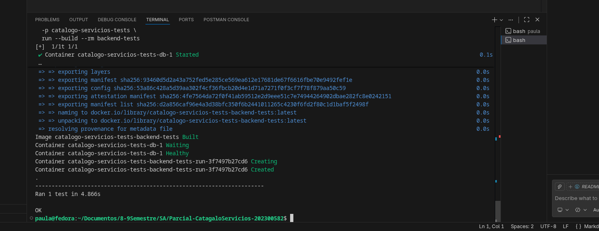

# Evidencia de validación

## Resultados ejecutados

| Control | Comando | Resultado |
|---|---|---|
| Sintaxis Python | `python -m compileall -q backend scripts tests` | OK |
| Sintaxis JavaScript de pruebas | `node --check tests/e2e/catalogo.spec.js` | OK |
| Importación sin escritura | `python -m backend.app.importer --dry-run` | 12 nivel 1, 46 nivel 2, 63 omitidas, 57 observadas |
| Unitarias | `python -m unittest tests.backend.test_importer_rules tests.backend.test_security` | 4 OK, 2 omitidas por dependencias del entorno |
| SQL | comprobación de restricciones y bloques `DO` | OK |

## Pendientes de ejecución en Fedora/Docker

Creacion de .env y creacion de secret

Instalar docker

Ejecutar Docker compose up --build -d



Ejecuccion de pruebas de integracion


Prueba unitaria de python 


Ejecuccion de prueba P12 


En el entorno donde se realizó esta revisión no estaban instalados Docker ni
`node_modules`, por lo que aún debe ejecutarse y capturarse:

```bash
docker compose up --build -d
docker compose -f compose.test.yaml -p catalogo-servicios-tests up -d db
python -m unittest tests.integration.test_scenarios
bash scripts/verify_persistence.sh
```

La prueba de integración debe usar únicamente `TEST_DATABASE_URL` apuntando al
puerto `55432`; nunca debe apuntar al volumen normal de evaluación.

## Evidencia de ciclo de corrección

El historial técnico registrado fue: tarea de importación → fallo al separar
bloques SQL `DO` → corrección del parser → validación de sintaxis, esquema y
prueba en seco satisfactoria. La evidencia final debe enlazar el commit que
contenga esta corrección y una captura o salida de consola sin secretos.
