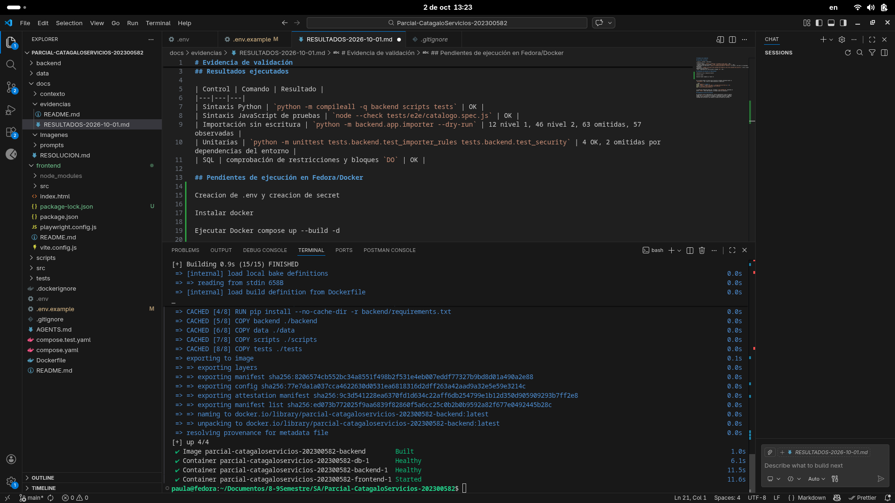
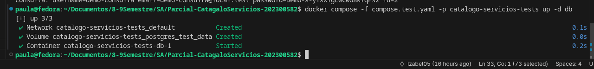
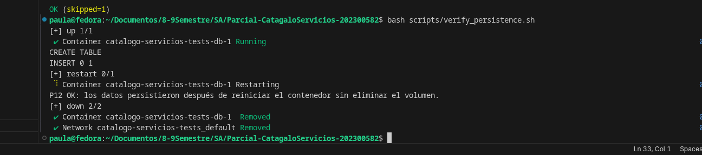
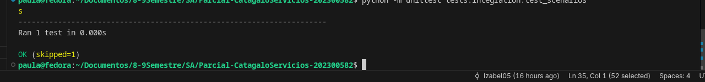

# Evidencia de validación

## Resultados ejecutados

| Control | Comando | Resultado |
|---|---|---|
| Sintaxis Python | `python -m compileall -q backend scripts tests` | OK |
| Sintaxis JavaScript de pruebas | `node --check tests/e2e/catalogo.spec.js` | OK |
| Importación sin escritura | `python -m backend.app.importer --dry-run` | 12 nivel 1, 46 nivel 2, 63 omitidas, 57 observadas |
| Unitarias | `python -m unittest tests.backend.test_importer_rules tests.backend.test_security` | 4 OK, 2 omitidas por dependencias del entorno |
| SQL | comprobación de restricciones y bloques `DO` | OK |

## Fotografías disponibles

### Construcción y arranque Docker



La captura muestra el build terminado y los contenedores `db`, `backend` y
`frontend` iniciados; debe conservarse sin pestañas o terminales que expongan
claves.

### Preparación de la base de pruebas



Esta captura demuestra la creación del volumen y contenedor de pruebas, pero no
el resultado de las pruebas de integración.

### Persistencia P12



Esta evidencia sí demuestra que el marcador sobrevivió al reinicio sin eliminar
el volumen.

### Captura que debe reemplazarse



Esta captura ejecuta `tests.integration.test_scenarios` y reporta `OK
(skipped=1)`. No es una prueba unitaria aprobada; debe repetirse con:

```bash
docker compose -f compose.test.yaml -p catalogo-servicios-tests run --build --rm backend-tests
docker compose exec backend python -m unittest tests.backend.test_importer_rules tests.backend.test_security
```

Toma una captura adicional del resultado de integración y otra de las pruebas
unitarias. No publiques contraseñas demo, claves AES ni valores completos de
`.env` en las fotografías.

## Pendientes de ejecución en Fedora/Docker

La evidencia que todavía falta capturar es:

```bash
docker compose up --build -d
docker compose -f compose.test.yaml -p catalogo-servicios-tests run --build --rm backend-tests
docker compose exec backend python -m unittest tests.backend.test_importer_rules tests.backend.test_security
bash scripts/verify_persistence.sh
```

La prueba de integración debe usar únicamente `TEST_DATABASE_URL` apuntando al
puerto `55432`; nunca debe apuntar al volumen normal de evaluación.

## Evidencia de ciclo de corrección

El historial técnico registrado fue: tarea de importación → fallo al separar
bloques SQL `DO` → corrección del parser → validación de sintaxis, esquema y
prueba en seco satisfactoria. La evidencia final debe enlazar el commit que
contenga esta corrección y una captura o salida de consola sin secretos.


